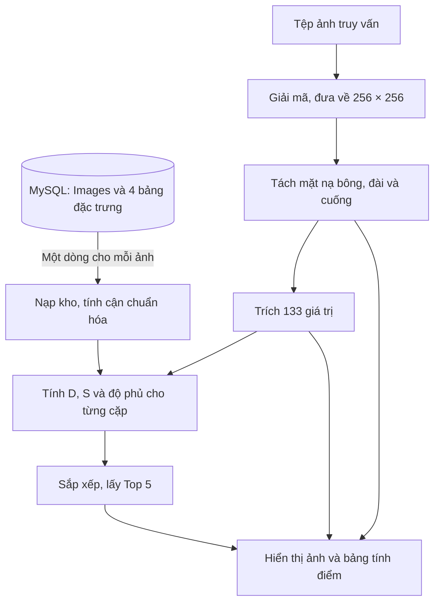

# Báo cáo phần 4 · Tìm kiếm ảnh bông hoa tương đồng

**Nhóm 10 · Bước 4–7 · Tính độ tương đồng, tìm Top 5 và đánh giá**

Ứng dụng nhận một ảnh hoa, đọc kho 1.128 bản ghi MySQL và trả về năm ảnh có điểm tương đồng S cao nhất trong các ứng viên còn lại sau khi lọc cùng nguồn. Với mỗi kết quả, có thể xem khoảng cách D, trọng số từng nhóm và độ phủ của các đặc trưng đo được.

**Cập nhật sau khi đối chiếu mặt nạ.** Phần [Sửa phân vùng và loại ảnh cùng nguồn](#sua-phan-vung) ở cuối tài liệu ghi các thay đổi và số liệu mới. Các cận chuẩn hóa, ví dụ tính tay và kết quả 22% trong phần triển khai ban đầu bên dưới mô tả phiên bản trước lần sửa này, dùng để đối chiếu. Sau khi trích lại kho, số đo và thứ hạng hiện hành được ghi ở phần cập nhật.

## Bước 4 · Tính độ tương đồng cho một cặp ảnh

### 4.1. Dữ liệu đầu vào và kiến thức sử dụng

Mỗi ảnh dùng đúng 133 số đo ở phần 3. Chương trình lấy bốn bảng đặc trưng thông qua `image_id`, chuyển histogram JSON thành mảng số, và đưa các cột MySQL về cùng thứ tự với đầu ra của bộ trích rút. Đối với truy vấn, chương trình đọc ảnh từ ổ đĩa và chạy chính bộ trích rút đó. Các bước chuẩn hóa và so sánh thực hiện trong bộ nhớ.

| Nhóm | Đầu vào | Cách so sánh | Trọng số cơ sở |
|---|---|---|---:|
| Màu | 108 ô HSV và 7 thống kê màu | Nửa khoảng cách L1 của histogram, kết hợp với Euclidean chuẩn hóa của 7 thống kê | 0,40 |
| Hình dạng | 5 số đo hình học và 7 Hu Moments | Euclidean chuẩn hóa trên 12 số | 0,30 |
| Đài | Chiều dài tương đối, góc đỉnh, mức bao sát, tỉ lệ diện tích | Euclidean chuẩn hóa trên các số cả hai ảnh đo được | 0,20 |
| Cuống | Độ dày và tỉ lệ độ dày/chiều rộng bông | Euclidean chuẩn hóa trên 2 số | 0,10 |

**Liên hệ với slide.** Lecture 11 trình bày luồng so sánh ảnh bằng đặc trưng ở trang PDF 4, chuẩn hóa histogram ở trang 13, khoảng cách Manhattan và phép giao histogram ở trang 15, bảy Hu Moments ở trang 31 và lựa chọn độ đo theo loại đặc trưng ở trang 36. Việc chia Euclidean cho căn số chiều, chọn mốc phân vị, phối trọng số và xử lý thiếu quan sát là các quyết định triển khai của nhóm. [Lecture 11 – Indexing and Retrieval for Image, trong thư mục slide của môn](<../../../MMDB slides/Lecture 11 - Indexing and Retrieval for Image.pdf>)

### 4.2. Chuẩn hóa trên kho tham chiếu

Đọc 1.128 ảnh đã lưu và tính cận riêng cho từng cột số. Cận dưới L là phân vị 1%, cận trên U là phân vị 99% của những giá trị quan sát được. Sắp xếp n giá trị tăng dần; vị trí của phân vị p là `(n−1) × p` với chỉ số bắt đầu từ 0. Nếu vị trí nằm giữa hai giá trị thì nội suy tuyến tính. Với mỗi giá trị x, áp dụng:

```text
z(x) = min(1, max(0, (x − L) / (U − L)))
```

Mọi ảnh trong kho và truy vấn dùng chung L, U. Ví dụ, Hu thứ 7 của kho có giá trị lớn nhất 0,000060805, trong khi phân vị 99% chỉ khoảng 0,000000664. Lấy cực đại làm cận trên sẽ ép nhiều chênh lệch nhỏ vào một vùng hẹp. Việc chặn ở hai đầu giúp giữ độ phân giải ở vùng có nhiều ảnh, đồng thời khiến hai giá trị vượt cùng một cận có thể có chênh lệch chuẩn hóa bằng 0. Khi thay kho hoặc cập nhật bộ trích rút, cần tính lại cận trên phiên bản kho mới.

- Nếu L = U, thử cực tiểu và cực đại của các số quan sát được. Nếu vẫn bằng nhau hoặc cả cột thiếu quan sát, bỏ chiều đó khi tính khoảng cách.
- H trung bình là góc tuần hoàn. Với cột H có biến thiên, dùng `δH = min(|Hq−Hx|, 360−|Hq−Hx|)/180`. Chẳng hạn 359° và 1° cách nhau 2°, cho δH = 0,011111. H vẫn là trung bình số học đã lưu ở phần 3. Hoa ít bão hòa hoặc có pixel nằm hai phía mốc 0° có thể cho H trung bình khó diễn giải.
- Histogram đã được chuẩn hóa theo tổng pixel. Kiểm tra đủ 108 ô hữu hạn, không âm và tổng sai lệch tối đa 10⁻⁶ so với 1, rồi chia lại cho tổng để loại sai số dấu phẩy động. Các ô dùng trực tiếp trong L1.
- Với các đại lượng thông thường, chênh lệch của một chiều là `δj = |zj(Q) − zj(X)|`. Số âm của gradient S và của Hu tham gia theo đúng dấu đã lưu.

#### Cận thực tế dùng cho lần tính trong báo cáo

Hàng đầu dùng miền góc vật lý. Các hàng còn lại dùng hai phân vị. Cột n cho biết số ảnh đóng góp quan sát vào từng phép chuẩn hóa.

| Cột MySQL | n | L | U |
|---|---:|---:|---:|
| `mean_h` | 1128 | 0 | 360 |
| `mean_s` | 1128 | 0.051633374 | 0.96077522 |
| `std_h` | 1128 | 2.7518677 | 174.29938 |
| `std_s` | 1128 | 0.034756431 | 0.33551969 |
| `entropy` | 1128 | 0 | 3.0061601 |
| `dominant_color_ratio` | 1128 | 0.23517055 | 1 |
| `gradient_s_radius` | 1128 | -0.91197577 | 0.48861025 |
| `area` | 1128 | 0.10381137 | 0.38671161 |
| `perimeter` | 1128 | 405.27 | 1146.65 |
| `circularity` | 1128 | 0.1315781 | 1.0400447 |
| `aspect_ratio` | 1128 | 0.58382063 | 2.112749 |
| `solidity` | 1128 | 0.52368211 | 0.96818515 |
| `hu_moment_1` | 1128 | 0.16272385 | 0.33068395 |
| `hu_moment_2` | 1128 | 1.4462479e-05 | 0.050407028 |
| `hu_moment_3` | 1128 | 2.0289948e-06 | 0.0087135359 |
| `hu_moment_4` | 1128 | 7.6096647e-08 | 0.001534352 |
| `hu_moment_5` | 1128 | -2.9693035e-07 | 2.2903768e-06 |
| `hu_moment_6` | 1128 | -3.7712292e-05 | 0.00014872846 |
| `hu_moment_7` | 1128 | -7.7166027e-07 | 6.6357719e-07 |
| `sepal_length_ratio` | 1109 | 0.074047552 | 0.56008964 |
| `sepal_sharpness` | 1109 | 21.356108 | 108.25732 |
| `calyx_adhesion` | 1111 | 0.01934998 | 0.06320572 |
| `calyx_area_ratio` | 1111 | 0.004019488 | 0.3114688 |
| `stem_thickness` | 885 | 1.1119972 | 51.088896 |
| `stem_width_ratio` | 885 | 0.006360228 | 0.25606264 |

### 4.3. Khoảng cách từng nhóm và điểm tổng

**Histogram.** Tính `Dhist = ½ × Σᵢ |hQ[i] − hX[i]|`. Hai histogram có tổng bằng 1 nên Dhist nằm trong [0, 1]. Có thể kiểm tra bằng công thức tương đương `1 − Σᵢ min(hQ[i], hX[i])`. Toàn bộ histogram tạo ra một khoảng cách.

**Các số đo còn lại.** Với k chiều hợp lệ chung, tính `RMS = √(Σⱼ δj² / k)`. Đây là khoảng cách Euclidean chia cho √k. Chẳng hạn, nếu mọi chiều khác nhau 0,2 thì RMS bằng 0,2 ở cả nhóm 2 chiều và nhóm 12 chiều. Trong nhóm hình dạng, mỗi số trong 12 số có cùng hệ số ở tổng bình phương, vì vậy khối bảy Hu đóng góp 7 trong 12 số hạng.

**Nhóm màu.** Tính `Dmàu = (Dhist + RMS_màu) / 2`. Khi đủ bốn nhóm, histogram có tổng trọng số 0,20, bảy thống kê màu cùng chia phần 0,20 còn lại. Nếu toàn bộ cột thống kê màu hằng trên kho, nhóm màu dùng riêng Dhist.

**Thiếu quan sát.** Trong phần 3, diện tích đài bằng 0 đánh dấu thiếu cả nhóm đài. Nếu có diện tích đài nhưng tỉ lệ chiều dài bằng 0, bỏ hai phép đo chiều dài và góc, vẫn dùng mức bao sát và diện tích. Độ dày cuống bằng 0 đánh dấu thiếu cả hai số đo cuống. Mọi quy tắc này được áp dụng trước khi ước lượng phân vị và trước khi so sánh cặp ảnh. Số 0 hợp lệ của entropy, gradient, Hu hoặc khoảng cách tới cánh vẫn có giá trị đo.

**Tổng hợp.** Ký hiệu b là trọng số cơ sở, m là số chiều có thể dùng trên kho trong một nhóm, k là số chiều cả hai ảnh cùng có. Nhóm hình dạng, đài và cuống có trọng số tạm `a = b × k/m`. Nếu m hoặc k bằng 0 thì a bằng 0 và khoảng cách nhóm hiển thị là “thiếu”. Nhóm màu có histogram hợp lệ nên luôn có a = 0,40.

```text
C = Σ a_g                     phần trọng số có dữ liệu để so
w_g = a_g / C                 trọng số thực dùng cho cặp ảnh
D = Σ w_g × D_g               cộng các nhóm có dữ liệu
S = 1 / (1 + D)               điểm tương đồng
```

D nằm trong [0, 1], S nằm trong [0,5, 1]. D giảm thì S tăng. C đo mức độ đầy đủ của phép so sánh và được trả cùng S. Khi thiếu cuống, hai ảnh có thể đạt điểm cao dựa trên màu, hình và đài; do đó cần xem cả C khi giải thích thứ hạng. S biểu thị mức gần nhau theo công thức, còn độ phù hợp với người xem cần đánh giá bằng các truy vấn ở bước 7.

Các trọng số 0,40 / 0,30 / 0,20 / 0,10 là lựa chọn ban đầu. Màu và dáng có số đo trên toàn kho và được ưu tiên. Đài giúp phân biệt hai bông cùng màu. Cuống có ít số đo hơn và thiếu ở 243 ảnh. Việc chọn trọng số tối ưu cần các đánh giá phù hợp của người xem.

### 4.4. Tính tay từ ảnh thật

#### Cặp đủ dữ liệu · 7.jpg và 1.jpg

1. **Histogram.** Ô 104 có tần suất 0,095040 và 0,503025, đóng góp 0,407985 vào tổng L1. Ô 95 đóng góp 0,224800 và ô 106 đóng góp 0,136162. Cộng đủ 108 ô được 1,481227620. Do đó Dhist = **0,740613810**.
2. **Màu.** S trung bình của hai ảnh là 0,6348539 và 0,528177. Với L = 0,051633374 và U = 0,96077522, hai số chuẩn hóa là 0,6415066 và 0,5241686. Chênh lệch của chiều này là 0,1173380. Riêng H có chênh lệch góc 17,74903°/180 ≈ 0,098606. Sau khi cộng bình phương đủ 7 chênh lệch và lấy căn trung bình, RMS_màu = 0,159341911. Kết hợp với histogram cho Dmàu = **0,449977860**.
3. **Cuống.** Độ dày chuẩn hóa là 0,2051276 và 0,3965153. Tỉ lệ độ dày chuẩn hóa là 0,2301957 và 0,6094846. Vì vậy `Dcuống = √[(0,1913877² + 0,3792889²)/2] = 0,300407`.
4. **Cộng theo nhóm.** Cả hai ảnh đủ bốn nhóm, C = 1. Mỗi hàng dưới đây là một số hạng của D.

| Nhóm | Khoảng cách | Trọng số | Đóng góp vào D |
|---|---:|---:|---:|
| Màu | 0,449978 | 0,40 | 0,179991 |
| Hình dạng | 0,117453 | 0,30 | 0,035236 |
| Đài | 0,215592 | 0,20 | 0,043118 |
| Cuống | 0,300407 | 0,10 | 0,030041 |

Từ các giá trị đầy đủ, D = **0,288386055**, suy ra S = 1/(1 + 0,288386055) = **0,776164874**. Các bảng trong báo cáo chỉ làm tròn ở lúc hiển thị.

#### Cặp thiếu quan sát · 7.jpg và 54.jpg

Ảnh 54 thiếu số đo cuống. Trọng số tạm là (0,4; 0,3; 0,2; 0), C = 0,9 và trọng số thực dùng là (4/9; 3/9; 2/9; 0). Từ ba khoảng cách thực đo:

```text
D = (0,4 × 0,529834173 + 0,3 × 0,267041732 + 0,2 × 0,177319519) / 0,9
  = 0,363900103
S = 1 / (1 + D) = 0,733191528
```

#### Đối chiếu các trường hợp

| Ứng viên so với 7.jpg | D màu | D hình | D đài | D cuống | C | D tổng | S |
|---|---:|---:|---:|---:|---:|---:|---:|
| 1.jpg | 0,449978 | 0,117453 | 0,215592 | 0,300407 | 1,00 | 0,288386 | 0,776165 |
| 715.jpg | 0,696648 | 0,216903 | 0,506496 | 0,074739 | 1,00 | 0,452503 | 0,688467 |
| 54.jpg | 0,529834 | 0,267042 | 0,177320 | thiếu | 0,90 | 0,363900 | 0,733192 |
| 87.jpg | 0,653829 | 0,279922 | 0,388349 | thiếu | 0,80 | 0,480429 | 0,675480 |
| 253.jpg | 0,597078 | 0,113599 | thiếu | thiếu | 0,70 | 0,389872 | 0,719490 |

Ứng viên 715 có cuống gần ảnh truy vấn hơn ứng viên 1, nhưng chênh lệch màu và đài lớn hơn nên điểm tổng thấp hơn. Với 87, vùng đài đo được hai trong bốn chiều, nên trọng số tạm của đài chỉ còn 0,20 × 2/4 = 0,10. Sau khi chia cho C = 0,80, trọng số thực của đài là 0,125. Với 253, phần so sánh chỉ dựa trên màu và hình.

### 4.5. Kiểm chứng và tái lập phép tính

- **Kiểm chứng công thức.** Đã chạy 7 bài kiểm tra cho histogram rời nhau, H qua mốc 0°, đài thiếu từng phần, cuống thiếu, phân vị có loại giá trị thiếu, cột hằng, trùng phân vị, chặn ngoài miền và đầu vào không hợp lệ. Ba phép kiểm phần 3 cũng chạy đạt.
- **Kiểm chứng với MySQL.** Cả 1.128 bản ghi tự so đều đạt S = 1. Với ảnh truy vấn 7 đọc lại từ JPEG, cả 1.128 cặp tính hai chiều cho cùng S, tổng trọng số thực bằng 1 trong dung sai 10⁻¹² và S thuộc miền đã định. Khi so JPEG số 7 với bản ghi số 7 trong MySQL, S = 0,999999504; sai biệt nhỏ xuất hiện do các cột FLOAT lưu và trả về số với độ chính xác hữu hạn.
- **Bước 5.** Dùng chung một `Scale.fit` cho một phiên bản kho. Tạo truy vấn bằng `Descriptor.from_extracted`, so với từng `Descriptor.from_row` bằng `scale.compare`. Quy ước xếp hạng là S giảm dần, nếu bằng nhau thì C giảm dần rồi `image_id` tăng dần. Dùng số đầy đủ để xếp hạng rồi mới làm tròn. Khi thử bằng ảnh có sẵn trong kho để đánh giá, loại đúng ID truy vấn.
- **Bước 6.** Trả cùng tên ảnh và ID các khóa `distances`, `weights`, `coverage`, `total_distance` và `similarity`. Hiện “thiếu” cho khoảng cách nhóm có giá trị `None`. Tích trọng số thực với khoảng cách nhóm cho biết mỗi nhóm đóng góp bao nhiêu vào D.
- **Bước 7.** Cố định công thức, trọng số và kho khi chấm cùng một bộ truy vấn. Ghi Precision@5 theo tiêu chí tương đồng do nhóm xác định trước. Các phép tự so và tính đối xứng ở bước này chỉ kiểm tra số học.

Chạy từ thư mục dự án. Lệnh minh họa đọc MySQL, in cận cho toàn bộ 25 đại lượng, giá trị trước và sau chuẩn hóa của từng cặp và kết quả nghiệm thu.

```powershell
.\.venv\Scripts\python.exe -m unittest -v test_similarity test_phan_3
.\.venv\Scripts\python.exe minh_hoa_do_tuong_dong.py --query "..\data\7.jpg" --candidates 1.jpg 715.jpg 54.jpg 87.jpg 253.jpg 7.jpg --check
```

[Mã tính điểm](../../similarity.py) · [Chương trình tái lập](../../minh_hoa_do_tuong_dong.py) · [Bộ kiểm tra](../../test_similarity.py) · [Báo cáo phần 3](../phan_3/bao_cao_phan_3.md)

## Bước 5 · Tìm Top 5 trên MySQL

### Các khối và dữ liệu trao đổi



| Khối | Đầu vào | Đầu ra cho khối kế tiếp |
|---|---|---|
| Nạp kho · `read_catalog`, `FlowerCatalog` | Bảng `Images` và bốn bảng nối theo `image_id` | ID, tên, đường dẫn và đặc trưng mỗi ảnh, cùng cận dùng chung cho kho |
| Giải mã và phân đoạn · `decode_query`, `preprocess_image` | Dữ liệu tệp truy vấn | Ảnh BGR chuẩn 256 × 256, ba mặt nạ bông, đài, cuống |
| Trích đặc trưng · `features_from_masks` | Ảnh chuẩn và các vùng đã tách | Histogram HSV 108 ô và 25 đại lượng của bốn nhóm |
| So sánh và xếp hạng · `Scale.compare`, `FlowerCatalog.rank` | Đặc trưng truy vấn, đặc trưng kho, cận chuẩn hóa | Năm bản ghi kèm D từng nhóm, trọng số, D tổng, S và độ phủ C |
| Hiển thị · Streamlit | Đường dẫn ảnh kết quả, các phép tính và mặt nạ truy vấn | Năm ảnh theo thứ hạng và bảng để xem lại phép tính của từng ảnh |

### Cách xếp hạng và đối chiếu

Chương trình đọc ảnh và bốn bộ đặc trưng bằng một phép JOIN, sau đó tính cận chuẩn hóa cho phiên bản kho vừa đọc. Mỗi lượt truy vấn giải mã JPEG, đưa ảnh về 256 × 256, phân đoạn một lần và tính lại bốn bộ đặc trưng. Với ảnh chữ nhật, chương trình giữ tỉ lệ, đưa cạnh dài về 256 và bù phần thiếu bằng pixel biên. Ảnh kho chuẩn 256 × 256 dùng trực tiếp. Cùng một lần phân đoạn cung cấp cả số đo cho phép so sánh lẫn mặt nạ để người xem đối chiếu.

Hệ thống so cặp truy vấn với từng ảnh bằng đúng hàm ở bước 4, giữ S, C, D và các khoảng cách thành phần. Khóa sắp xếp là `(-S, -C, image_id)`. Sau khi sắp xếp bằng độ chính xác đầy đủ, lấy tối đa năm dòng đầu. Với N ảnh và số chiều cố định, khâu tính điểm tốn O(N), khâu sắp xếp tốn O(N log N) và danh sách kết quả trung gian tốn O(N) bộ nhớ. Trong ứng dụng, một lần tìm quét cả 1.128 bản ghi. Tham số `exclude_id` phục vụ phép thử có ảnh truy vấn xuất phát từ chính kho.

| Ảnh thử trong kho | Số ứng viên sau khi loại chính ID | Năm ID theo thứ hạng | S hạng 1 |
|---|---:|---|---:|
| 7.jpg | 1.127 | 294, 75, 779, 421, 438 | 0,871996 |
| 715.jpg | 1.127 | 675, 345, 873, 987, 618 | 0,819031 |
| 803.jpg | 1.127 | 811, 810, 804, 216, 96 | 0,838141 |

Đã kiểm tra cả ba danh sách bằng cách trích lại truy vấn qua bộ trích rút phần 3, so từng cặp và sắp thứ tự độc lập. Mỗi danh sách khớp cả năm ID. [Mã truy vấn](../../searcher.py)

## Bước 6 · Giao diện và kết quả trung gian

Người dùng chọn ảnh JPG/JPEG, xem ảnh mà hệ thống sẽ đo và nhấn **Tìm 5 ảnh giống nhất**. Mỗi ảnh kết quả có hạng, tên tệp, S và độ phủ C. Bảng chi tiết cho phép đối chiếu các khoảng cách màu, hình, đài, cuống, D tổng và S; chọn từng hạng để xem trọng số thực, tích trọng số với khoảng cách từng nhóm và khoảng cách histogram. Phần đặc trưng truy vấn hiển thị ba mặt nạ, số pixel, 25 giá trị vô hướng và 108 ô HSV theo bố cục 12 hàng × 9 cột. Chữ **Thiếu** biểu thị đại lượng chưa quan sát được.

Ứng dụng dùng một bản kho và cận chuẩn hóa trong bộ nhớ đệm tối đa 60 giây. Kết quả thuộc phiên làm việc của người dùng; thay hoặc bỏ tệp truy vấn sẽ xóa kết quả cũ. Thời gian trích đặc trưng và thời gian xếp hạng hiển thị riêng. [Giao diện Streamlit](../../main.py)

### Đi từ ảnh truy vấn đến điểm của một kết quả

Tải `lotus_0001.jpg` (1.181 × 1.181 pixel) vào ứng dụng đang dùng kho đầy đủ. Ở kích thước chuẩn, mặt nạ bông có 23.467 pixel, tương ứng 23.467 / 65.536 = **0,358078** diện tích ảnh. Chu vi đo được 870 pixel và độ bão hòa trung bình là 0,455514. Vùng đài có 572 pixel, nên tỉ lệ diện tích đài/bông bằng 572 / 23.467 = **0,024375**. Vùng cuống có 960 pixel trên 24 hàng, cho độ dày trung bình **40 pixel**. Trên hình, vùng cuống chỉ là một mảng ở mép dưới. Điều này cho thấy mặt nạ có thể cho ra số đo dù chưa bám đúng đường cuống nhìn thấy.


Năm kết quả của giao diện lần lượt là **992, 1011, 551, 462, 304**. Với ảnh hạng 1 (`992.jpg`), khoảng cách histogram bằng 0,039102. Đủ bốn nhóm nên C = 1. Phép tính dưới đây dùng các khoảng cách nhóm đã làm tròn để người đọc đối chiếu.

```text
D = 0,40 × 0,030001 + 0,30 × 0,092779 + 0,20 × 0,091238 + 0,10 × 0,087492
  ≈ 0,066831
S = 1 / (1 + D) ≈ 0,937356
```

Ảnh 992 là bản cắt cùng nguồn với truy vấn này. Đây là ví dụ tái lập kết quả trên giao diện. Phép đánh giá ở bước 7 loại ID 992 và năm bản cùng nguồn khác trước khi tính cận và xếp hạng.

Trong kho có **243/1.128 ảnh chưa đo được cuống**. Với truy vấn `54.jpg` thuộc nhóm này, ở hạng 1 giao diện hiển thị **Thiếu** ở khoảng cách cuống, trọng số cuống **0%** và độ phủ **90%**. Độ phủ mô tả phần trọng số có số đo chung giữa hai ảnh. Ví dụ mặt nạ cuống của ảnh sen ở trên minh họa vì sao độ phủ cao vẫn có thể đi kèm sai số phân đoạn. [Thống kê trích đặc trưng ở phần 3](../phan_3/bao_cao_phan_3.md)

## Bước 7 · Đánh giá truy vấn bằng ảnh thực tế

### Tập truy vấn và tiêu chí chấm

Chọn mười nhóm tiền tố tên tệp trong thư mục `BTL_TimKiemAnhHoa/BTL_TimKiemAnhHoa/cropped`: anemone, azalea, bird_of_paradise, daisy, freesia, hibiscus, lotus, poppy, rose và tulip. Trong từng nhóm, lấy tên tệp đầu tiên theo thứ tự chữ cái, trước khi chạy Top 5. Tên tệp dùng để nhận diện truy vấn. Kho MySQL có nhãn chung `bong hoa`, nên việc chấm dựa vào nội dung nhìn thấy trên ảnh.

Một số tệp truy vấn và ảnh trong kho là các bản cắt khác nhau của cùng một bức ảnh. Để tránh tính việc tìm lại chính bức ảnh đó là một lần tìm thành công, đối chiếu vùng giữa các ảnh ở nhiều tỉ lệ rồi xem trực tiếp các cặp nghi trùng. Cách này phát hiện năm bản cùng nguồn. Rà thêm các điểm ảnh cục bộ tương ứng bằng SIFT trên 10 × 1.128 cặp phát hiện bản phóng lớn của ảnh hoa hồng. SIFT ở đây chỉ phục vụ rà bản sao khi lập tập đánh giá. Điểm tìm kiếm vẫn tính từ bốn nhóm màu, hình, đài và cuống đã nộp. [Lecture 11, trang PDF 31](<../../../MMDB slides/Lecture 11 - Indexing and Retrieval for Image.pdf>)

<details>
<summary>Thông số dùng để rà bản cùng nguồn</summary>

Lượt thứ nhất so vùng giữa trên ảnh xám 48 × 48 ở nhiều tỉ lệ và xem các ứng viên có hệ số tương quan từ 0,90. Lượt thứ hai đưa ảnh về 256 × 256, lấy tối đa 240 điểm SIFT và giữ cặp điểm nếu khoảng cách đến láng giềng gần nhất dưới 0,75 lần khoảng cách đến láng giềng thứ hai. Tiếp đó kiểm tra các cặp điểm có cùng phù hợp với một phép dịch, quay và đổi tỉ lệ. Ngưỡng đưa vào đối chiếu là ít nhất 7 điểm nhất quán, chiếm ít nhất 55% cặp ghép, sai số vị trí tối đa 3 pixel và diện tích bao điểm ghép ở mỗi ảnh từ 35 pixel vuông.

</details>

| Tệp truy vấn | Bản cùng nguồn trong kho | Điểm ghép nhất quán |
|---|---|---:|
| daisy_0004.jpg | 668.jpg | 169 |
| hibiscus_0012.jpg | 848.jpg | 165 |
| lotus_0001.jpg | 992.jpg | 88 |
| poppy_0004.jpg | 1067.jpg | 107 |
| rose_0005.jpg | 1079.jpg | 43 |
| tulip_0003.jpg | 1115.jpg | 58 |

Cả mười truy vấn dùng chung **1.122 ảnh tham chiếu** sau khi loại sáu bản cùng nguồn khỏi danh sách ứng viên và khỏi phép tính phân vị. Ứng dụng tìm kiếm thông thường dùng đủ 1.128 ảnh. Hai phép rà và đối chiếu trực quan vẫn có thể bỏ sót bản cùng nguồn khi ảnh bị cắt mạnh.

Quy ước một kết quả phù hợp khi **đạt đồng thời hai điều kiện** dưới đây. Mỗi cặp nhận hai nhãn nhị phân riêng.

1. **Màu cánh**. So họ màu chiếm ưu thế của bông trung tâm: trắng/kem, vàng, cam, đỏ, hồng, tím, xanh. Chấp nhận chênh lệch đậm nhạt trong cùng họ. Nếu hai màu cùng nổi bật, cặp màu chính phải tương ứng. Bỏ qua nền, lá và nhị khi xác định màu cánh.
2. **Dáng bông**. So hình dáng các cánh và độ mở nhìn thấy: nụ khép, dạng chén/cốc, bông nở xòe theo tâm, bông có cánh rủ/xòe một phía hoặc dáng bất đối xứng đặc thù. Với dáng đặc thù, xét cả bố cục cánh. Ví dụ một nụ đỏ và một bông đỏ nở bung đạt tiêu chí màu nhưng trượt tiêu chí dáng.

Mỗi truy vấn có năm kết quả. Precision@5 bằng số ảnh đạt cả hai điều kiện chia 5, sau đó lấy trung bình trên mười truy vấn. Khi chấm trực quan, phiếu hiển thị ảnh truy vấn cạnh năm ảnh ứng viên A–E, ẩn điểm S và xáo thứ tự hiển thị. Đây là lượt chấm của trợ lý trên 50 cặp theo cùng một quy ước. [Phiếu ảnh ẩn hạng và điểm](danh_gia/phieu_an_danh.jpg) · [Nhãn màu và dáng của 50 cặp](danh_gia/nhan_truc_quan.csv)

### Kết quả truy hồi

| Truy vấn | ID theo hạng 1 → 5 | Đạt cả hai / 5 | Precision@5 | Trung vị 3 lượt (ms) |
|---|---|---:|---:|---:|
| Q01 · `anemone_0003.jpg` | 491, 323, 289, 241, 92 | 0/5 | 0% | 384,2 |
| Q02 · `azalea_0002.jpg` | 92, 629, 996, 603, 414 | 0/5 | 0% | 362,9 |
| Q03 · `bird_of_paradise_0001.jpg` | 274, 842, 814, 616, 1109 | 0/5 | 0% | 307,4 |
| Q04 · `daisy_0004.jpg` | 855, 532, 109, 35, 625 | 0/5 | 0% | 319,3 |
| Q05 · `freesia_0013.jpg` | 381, 186, 1013, 617, 991 | 1/5 | 20% | 331,8 |
| Q06 · `hibiscus_0012.jpg` | 510, 739, 503, 81, 1018 | 1/5 | 20% | 219,4 |
| Q07 · `lotus_0001.jpg` | 1011, 551, 462, 304, 94 | 2/5 | 40% | 191,0 |
| Q08 · `poppy_0004.jpg` | 951, 56, 648, 691, 755 | 0/5 | 0% | 229,7 |
| Q09 · `rose_0005.jpg` | 150, 440, 353, 445, 556 | 4/5 | 80% | 533,1 |
| Q10 · `tulip_0003.jpg` | 292, 894, 327, 1072, 1104 | 3/5 | 60% | 230,5 |

**Precision@5 trung bình bằng 11/50 = 22%**. Năm trong mười truy vấn có ít nhất một kết quả đạt cả hai tiêu chí. Nếu xét riêng, 40/50 kết quả (80%) khớp màu cánh và 13/50 (26%) khớp dáng. Trong 50 cặp có 11 cặp đạt cả hai, 29 cặp chỉ khớp màu, 2 cặp chỉ khớp dáng và 8 cặp trượt cả hai. [Ảnh truy vấn và 50 kết quả theo đúng thứ hạng](danh_gia/top5.jpg) · [Bảng điểm, độ phủ, khoảng cách và trọng số từng cặp](danh_gia/ket_qua_top5.csv)

- **Hoa hồng Q09.** Bốn ảnh đạt cả màu hồng và dáng cánh xếp lớp. Ảnh hạng 1 (ID 150) có D màu = 0,132624, D hình = 0,170258 và D đài = 0,245198. Vì truy vấn thiếu số đo cuống, D = (0,4 × 0,132624 + 0,3 × 0,170258 + 0,2 × 0,245198) / 0,9 ≈ 0,170185, nên S ≈ 0,854566. Ảnh hạng 4 (ID 445) là nụ đỏ, hẹp và khép hơn bông truy vấn nên trượt cả hai tiêu chí.
- **Hoa thiên điểu Q03.** Ba kết quả đầu có tông cam. Cả năm ảnh đều trượt tiêu chí dáng vì thiếu bố cục cánh dài, nhọn, xòe lệch một phía của truy vấn. Riêng ID 274 vẫn đứng đầu với S = 0,740317. Đường bao tổng thể và các mômen hình học chỉ mô tả một phần cách các cánh phân bố bên trong bông.
- **Hoa sen Q07.** Sau khi loại bản cùng nguồn, hạng 1 là ID 1011 với S = 0,827856. Ảnh này khớp màu nhưng dáng khép hơn truy vấn. Hai ảnh hạng 2 và 3 (ID 551 và 462) đạt cả hai tiêu chí, nên Precision@5 = 2/5.

### Hiệu năng và phạm vi kết luận

Mỗi ảnh truy vấn chạy ba lần trên cùng một kho. Cả ba lần cho cùng năm ID theo cùng thứ tự. Trong lần đo ngày **21/11/2026**, đọc bản ghi từ MySQL và tính cận cho 1.122 ảnh tốn **134,1 ms** một lần. Từng lượt sau đó được đo từ lúc đọc tệp truy vấn đến khi lấy đủ Top 5, gồm cả giải mã và đưa ảnh về kích thước chuẩn.

| Đại lượng | Số đo trên máy chạy |
|---|---:|
| Tách vùng và trích đặc trưng, trung bình 30 lượt | 228,0 ms |
| Tính điểm và xếp hạng 1.122 ứng viên, trung bình 30 lượt | 77,5 ms |
| Từ đọc tệp đến Top 5, trung bình 30 lượt | **314,1 ms** |
| Trung vị (P50) của 30 lượt | 318,1 ms |
| Phân vị 95% (P95) của 30 lượt | 532,7 ms |

Các số đo lấy trên máy của nhóm với Python 3.13.6, OpenCV 5.0.0 và NumPy 2.5.4. Khoảng thời gian hiển thị ảnh trong trình duyệt nằm ngoài phạm vi đo. Trong lần chạy này, khâu tách vùng và trích đặc trưng chiếm khoảng 73% thời gian từ đọc tệp đến Top 5. [Thời gian của cả 30 lượt](danh_gia/thoi_gian.csv)

Mười truy vấn và một lượt chấm trực quan cho biết hành vi của hệ thống trên bộ ví dụ này. Hai nhãn phản ánh màu và dáng nhìn thấy. Độ chính xác phân loại theo loài cần nhãn loài đáng tin cậy trong kho. Muốn tính Recall@5 còn cần biết tổng số ảnh phù hợp trong cả 1.122 ứng viên cho mỗi truy vấn. Bài đánh giá hiện có nhãn cho 50 cặp Top 5. Cách tách chất lượng truy hồi khỏi thời gian xử lý và cách tính precision dựa trên Lecture 1, trang PDF 52–55 và 61–62. [Lecture 1 – Introduction](<../../../MMDB slides/Lecture 1 - Introduction.pdf>)

### Tái lập các bước 5–7

Từ thư mục dự án, dùng MySQL đã nạp dữ liệu ở phần 3 và thư mục truy vấn ghi ở đầu bước 7.

```powershell
.\.venv\Scripts\python.exe -m unittest -v test_phan_3 test_similarity test_searcher
.\.venv\Scripts\python.exe -m streamlit run main.py
```

Trong một cửa sổ PowerShell khác, lệnh đầu dưới đây tạo phiếu chấm ẩn danh. Lệnh thứ hai đối chiếu các nhãn đã lưu với ID trong Top 5, chạy ba lượt cho mỗi truy vấn và xuất lại các bảng, ảnh minh họa. Nếu kho thay đổi làm một ID trong Top 5 thay đổi, chương trình báo cặp cần chấm lại.

```powershell
.\.venv\Scripts\python.exe danh_gia_top5.py --blind --repeats 1
.\.venv\Scripts\python.exe danh_gia_top5.py --repeats 3 --export
```

Đã chạy đạt 14 phép kiểm tự động cho phần trích rút, tính điểm và xếp hạng. Đã kiểm tra thêm bằng Streamlit trên MySQL thực các thao tác tải ảnh, tìm Top 5, chọn hạng để xem phép tính, thay ảnh bằng tệp trùng tên, tải tệp hỏng và bỏ tệp truy vấn. [Mã đánh giá](../../danh_gia_top5.py) · [Kiểm thử xếp hạng và đọc ảnh](../../test_searcher.py)

<a id="sua-phan-vung"></a>

## Sửa phân vùng và loại ảnh cùng nguồn · 21/11/2026

### Vấn đề đã đối chiếu

Với truy vấn `lotus_0001.jpg`, mặt nạ cuống cũ là hình chữ nhật 40 × 24 pixel ở đáy ảnh. Có 920/960 pixel của mặt nạ này nằm trong 23 hàng cuối giống hệt nhau. Độ dày 40 pixel được tính từ vùng lặp biên. Mặt nạ đài cũ còn lấy các mảng xanh rời gần đáy bông. Vì vậy, việc công thức tính đúng từ những số đo ấy vẫn có thể dẫn tới kết quả khác nhiều so với nhận xét trực quan.

Mã cắt ảnh của nhóm dùng `BORDER_REPLICATE`. Log hiện có lưu cạnh cắt và tỉ lệ viền lớn nhất, nên chưa đủ thông tin để khôi phục chính xác độ dày từng mép cho toàn kho đã đổi tên. Bản sửa ước lượng dải lặp ngay trên ảnh đầu vào.

### Cách xác định vùng dùng để đo

Từ mỗi mép, so từng hàng hoặc cột liên tiếp với hàng hoặc cột ngoài cùng. Chấp nhận dải lặp khi sai khác màu trung bình tối đa 1 mức trên thang 0–255, phân vị 95% sai khác tối đa 3 mức và có ít nhất ba hàng hoặc cột lặp liên tiếp. Đường biên phải có độ biến thiên màu ngang đủ lớn để có bằng chứng lặp hoa văn. Nền phẳng đơn sắc được giữ lại. Giới hạn dò ở mỗi phía là dưới một nửa kích thước ảnh.

Mặt nạ `valid_mask` đánh dấu vùng dùng để đo. Mặt nạ bông, đài và cuống đều bị giới hạn trong vùng này. Hình ảnh gốc tiếp tục được hiển thị đầy đủ. Nếu có số đo viền từ lần cắt, hàm `preprocess_image` nhận trực tiếp bộ `padding=(top, bottom, left, right)` theo pixel của ảnh đang đo.

Với kho hiện tại, bộ dò tìm được dải lặp ở **733/1.128 ảnh**. Đây là số trường hợp được bộ dò nhận ra. Các dải bị nén JPEG mạnh hoặc sát vùng nền phẳng có thể bị bỏ sót. Một vùng ảnh thật có hoa văn lặp cũng có thể bị loại nhầm. Muốn biết độ chính xác của bộ dò cần đối chiếu với tọa độ cắt hoặc mặt nạ do người đánh dấu. [Mã xử lý vùng ảnh](../../image_regions.py)

### Tách đài và cuống

Ứng viên đài cần ở sát cánh, thuộc vùng xanh và có phần xòe ngang. Bộ lọc loại các thành phần kéo dài theo phương dọc, quá xa cánh hoặc quá lớn so với bông. Với cuống, chương trình tìm một đoạn hẹp gần gốc bông rồi lần xuống dưới. Đoạn quá ngắn hoặc có độ dày lớn so với bông được đánh dấu chưa đo được. Quy tắc này ưu tiên các ảnh có bông ở giữa và cuống hướng xuống như đầu vào đã chọn.

Trong ảnh sen, vùng đài mới trống. Cuống mới đo được trên đoạn ảnh thật, có độ dày khoảng **7,86 pixel**. Mặt nạ vẫn là ước lượng hình học từ ảnh hai chiều. Lá nằm sát gốc, cuống nghiêng mạnh, đài xanh vàng và cánh có màu gần lá vẫn gây khó cho cách tách này.

Hình đối chiếu có sáu cột theo thứ tự ảnh đầu vào, ảnh chồng màu, vùng dùng để đo, mặt nạ bông, mặt nạ đài và mặt nạ cuống. Trên ảnh chồng màu, vàng đánh dấu vùng đài và xanh lam đánh dấu vùng cuống. [Chín ví dụ mặt nạ sau sửa](danh_gia/sua_phan_vung/mat_na_moi.jpg)

### Đài tiêu biến theo xác nhận của nhóm

Nhóm hiện chưa có danh sách ảnh xác nhận đài tiêu biến. Vì vậy, trạng thái xác nhận ban đầu của kho là `unknown`. Tạo bảng quan hệ `Image_Review` với khóa ngoại `image_id`, trạng thái `unknown/present/absent`, ghi chú căn cứ và thời điểm cập nhật. Bảng này lưu thông tin xác nhận phục vụ quản lý phép đo.

Lệnh `image_review.py --file TEN_ANH.jpg --calyx absent --note "Căn cứ của nhóm"` cập nhật trạng thái và các đặc trưng của đúng ảnh trong một giao dịch. Với `absent`, cả bốn số đo đài được lưu theo quy ước thiếu đang dùng rồi loại khỏi phép so. Khi nạp lại kho, xác nhận đã lưu tiếp tục có hiệu lực. Có thể chuyển lại `unknown` hoặc `present` bằng cùng lệnh khi đối chiếu lại.

Đối với ảnh mới tải lên, người dùng có thể chọn **Tôi xác nhận bông trong ảnh có đài tiêu biến**. Xác nhận này chỉ áp dụng cho truy vấn hiện tại và được bỏ khi thay tệp. Nếu chưa xác nhận, chương trình thử tách vùng đài và trả thiếu quan sát khi chưa có vùng đo hợp lệ. [Quản lý xác nhận](../../image_review.py)

### Tìm ảnh cùng nguồn trước khi lấy Top 5

Ứng dụng bật mặc định **Loại ảnh trùng và bản cắt cùng nguồn**. Với pixel giống hệt sau chuẩn hóa kích thước, so mã băm của mảng ảnh. Với bản cắt hoặc thay đổi kích thước, ghép tối đa 240 điểm SIFT và kiểm tra sự nhất quán của phép dịch, quay và đổi tỉ lệ. Độ đo dùng để xếp Top 5 tiếp tục được tính từ 133 giá trị màu, hình, đài và cuống.

Ngưỡng bộ lọc gồm tỉ lệ hai khoảng cách láng giềng dưới 0,70, ít nhất 10 cặp điểm nhất quán, chiếm từ 65% cặp ghép, sai số vị trí tối đa 2,5 pixel, tỉ lệ phóng trong [0,2; 5] và diện tích bao các điểm khớp từ 100 pixel vuông trên mỗi ảnh. Đã kiểm tra được cả sáu cặp cùng nguồn ở bảng đánh giá ban đầu, gồm `lotus_0001.jpg` với `992.jpg`. Các ảnh ít chi tiết hoặc bị cắt rất mạnh vẫn có thể không được nhận ra. Các trường hợp hình ảnh lặp rất giống nhau cũng cần người xem đối chiếu.

Các ảnh bị loại được hiển thị theo tên. Người dùng có thể tắt bộ lọc để kiểm tra việc tìm lại ảnh có sẵn. Sau lọc, ứng dụng xếp hạng các ứng viên còn lại và lấy tối đa năm kết quả. Nếu toàn bộ kho bị loại, giao diện báo chưa còn ứng viên. [Mã lọc cùng nguồn](../../source_filter.py)

### CSDL và kiểm chứng

Đã lưu [bản sao đặc trưng trước lần sửa](danh_gia/sua_phan_vung/dac_trung_truoc_sua.json), trích lại 1.128 ảnh rồi ghi đủ bốn bảng đặc trưng trong một giao dịch. Đọc lại MySQL xác nhận mỗi bảng có 1.128 dòng, các histogram hợp lệ và năm ví dụ đối chiếu khớp đủ 133 giá trị trong dung sai FLOAT.

| Số ảnh theo tình trạng đo | Trước sửa | Sau sửa |
|---|---:|---:|
| Chưa đo được vùng đài | 17 | 238 |
| Chưa đo được cuống | 243 | 525 |

Sau sửa có 26 ảnh đo được vùng đài nhưng chưa đo được đầu lá đài. Số ảnh thiếu quan sát tăng do phép đo yêu cầu vùng hợp lệ chặt hơn. Các con số này mô tả đầu ra của bộ trích rút, cần mặt nạ tham chiếu để đánh giá tỷ lệ phân đoạn đúng.

Đã kiểm chứng riêng việc loại dải lặp trên ảnh nhân tạo, bảo toàn nền đơn sắc, tôn trọng tọa độ viền được cung cấp, xử lý đài tiêu biến và nhận bản cắt cùng nguồn. Phép thử giao dịch xác nhận đài tiêu biến được hoàn tác sau kiểm tra để kho tiếp tục có đúng những xác nhận do nhóm cung cấp. [Kiểm thử vùng ảnh và lọc nguồn](../../test_regions.py)

### Đánh giá lại sau sửa

Dùng lại mười truy vấn và 1.122 ảnh tham chiếu, loại cùng sáu bản cùng nguồn trước khi tính cận. Chấm theo hai điều kiện màu cánh và dáng bông đã nêu ở bước 7. Với những cặp ảnh xuất hiện trong cả hai lần đánh giá, giữ đúng nhãn đã chấm. Các cặp mới được trợ lý chấm trên phiếu A–E ẩn điểm và thứ hạng. Đây là đánh giá mô tả trên tập đã dùng để xem lỗi. Một bộ truy vấn độc lập và người chấm thứ hai sẽ giúp đánh giá khả năng tổng quát hóa. [Phiếu ẩn hạng](danh_gia/sua_phan_vung/phieu_an_danh.jpg) · [Nhãn 50 cặp sau sửa](danh_gia/sua_phan_vung/nhan_truc_quan.csv)

| Truy vấn | Năm ID sau sửa | P@5 trước | P@5 sau |
|---|---|---:|---:|
| Q01 · anemone | 92, 825, 323, 718, 218 | 0% | 20% |
| Q02 · azalea | 629, 218, 749, 92, 414 | 0% | 0% |
| Q03 · bird_of_paradise | 274, 235, 842, 224, 814 | 0% | 0% |
| Q04 · daisy | 855, 245, 54, 507, 169 | 0% | 0% |
| Q05 · freesia | 381, 1016, 862, 1013, 469 | 20% | 0% |
| Q06 · hibiscus | 510, 739, 1018, 171, 503 | 20% | 20% |
| Q07 · lotus | 661, 993, 935, 242, 319 | 40% | 80% |
| Q08 · poppy | 951, 1071, 755, 56, 811 | 0% | 20% |
| Q09 · rose | 150, 440, 445, 709, 353 | 80% | 80% |
| Q10 · tulip | 292, 1094, 327, 1104, 29 | 60% | 80% |
| Trung bình | | **22%** | **30%** |

Sau sửa có 42/50 ảnh khớp màu, 15/50 ảnh khớp dáng và cả 15 ảnh này đạt đồng thời hai điều kiện. Có sáu truy vấn tìm được ít nhất một ảnh đạt. Bốn truy vấn vẫn có P@5 bằng 0 và freesia giảm từ 20% xuống 0%. Bộ thuộc tính tổng thể còn khó phân biệt cách xếp từng cánh ở những bông có dáng đặc thù. [Hình kết quả theo hạng](danh_gia/sua_phan_vung/top5.jpg) · [Toàn bộ phép tính 50 cặp](danh_gia/sua_phan_vung/ket_qua_top5.csv)

Trong ứng dụng dùng đủ 1.128 ảnh, truy vấn sen loại `992.jpg`, so với 1.127 ứng viên và trả về cùng năm ID **661, 993, 935, 242, 319**. Điểm lần lượt là **0,875140; 0,856500; 0,850838; 0,845001; 0,836166**. Bốn kết quả là ảnh sen theo đối chiếu trực quan. Ảnh 935 có dáng chuông rủ và vẫn lọt vào hạng 3, minh họa giới hạn của hình bao cùng các mômen hình học. Điểm của ứng dụng hơi khác bảng đánh giá do cận chuẩn hóa được tính từ kho đầy đủ.

Đã mở ứng dụng và chạy lại truy vấn sen trong Chrome. [Ảnh chụp giao diện sau sửa](danh_gia/sua_phan_vung/giao_dien_sen.png)

Giữ trọng số cơ sở **0,4 / 0,3 / 0,2 / 0,1** để đánh giá tác động của lần sửa phân vùng. Việc tăng trọng số hình dạng trên chính mười ví dụ đã xem có thể làm kết quả lệch theo tập này. Chưa có bộ nhãn độc lập đủ để chọn một cấu hình trọng số tốt hơn một cách đáng tin cậy.

Ba lượt chạy mỗi truy vấn cho cùng thứ hạng. Trong lần đo 30 lượt, thời gian trung bình từ đọc ảnh đến Top 5 là **688,1 ms**, gồm trung bình 296,0 ms phân vùng và trích đặc trưng, 259,4 ms kiểm tra cùng nguồn và 121,9 ms tính điểm, xếp hạng. Trung vị bằng 675,6 ms và P95 bằng 965,5 ms. Khởi tạo kho, cận và các điểm dùng lọc nguồn mất 42,6 giây trong lần đo này, được đo riêng trước 30 lượt truy vấn. Hai lần kiểm tra trước ghi nhận khoảng 12,7–17,0 giây cho phần khởi tạo, cho thấy thời gian phụ thuộc tải của máy. Mã hiện có bộ nhớ đệm điểm theo đường dẫn, thời điểm sửa và kích thước tệp để tái sử dụng khi chỉ nạp lại đặc trưng từ MySQL. [Số đo 30 lượt](danh_gia/sua_phan_vung/thoi_gian.csv)

Đã chạy đạt **17 phép kiểm tự động**, kiểm chứng 1.128 phép tự so và 1.128 cặp so hai chiều. Kiểm thử giao diện với MySQL thực xác nhận lọc ảnh cùng nguồn, bật/tắt bộ lọc, chọn hạng để xem điểm, xác nhận đài tiêu biến, bỏ xác nhận khi đổi tệp cùng tên, xử lý tệp hỏng và bỏ tệp tải lên. Nhãn xác nhận đài của kho vẫn chờ nhóm cung cấp cho từng ảnh.

Lệnh đánh giá mặc định hiện dùng nhãn của phiên bản sau sửa. Chạy từ thư mục dự án.

```powershell
.\.venv\Scripts\python.exe -m unittest -v test_phan_3 test_similarity test_searcher test_regions
.\.venv\Scripts\python.exe kiem_chung_csdl.py
.\.venv\Scripts\python.exe danh_gia_top5.py --repeats 3 --export
.\.venv\Scripts\python.exe -m streamlit run main.py
```

<a id="dang-dac-biet"></a>

## Thử các bông có dáng đặc biệt trong kho · 22/11/2026

Chọn sáu ảnh có sẵn trong MySQL trước khi xem kết quả truy vấn, dựa trên dáng nhìn thấy. Dùng tên tệp để xác định ảnh vì kho hiện có nhãn loài chung. Mỗi ảnh chạy qua cùng đường xử lý với giao diện, gồm trích lại đặc trưng, lọc cùng nguồn và lấy Top 5. Loại đúng ID truy vấn đồng thời áp dụng bộ lọc bản cùng nguồn. Cận chuẩn hóa lấy từ toàn kho như trong ứng dụng.

Trong lượt thử này, chấm riêng việc khớp dáng của 30 kết quả để xem khả năng phân biệt hình dạng. Tiêu chí tương ứng với từng truy vấn được ghi ở bảng dưới. Màu cánh có thể khác. Các số đếm này cần được đọc theo tiêu chí hình dạng của lượt thử này. Precision@5 ở bộ mười truy vấn trước dùng đồng thời màu và dáng.

| Ảnh truy vấn | Dáng được dùng để đối chiếu |
|---|---|
| `935.jpg` | Bông rủ xuống dạng chuông dài, cánh bao quanh thân bông, phần miệng ở dưới |
| `274.jpg` | Cánh hẹp quặt ngược lên, nhị hoặc nhụy kéo dài xuống dưới |
| `803.jpg` | Bông dạng đĩa nhìn nghiêng, nhiều cánh nhỏ xếp dày quanh đầu bông |
| `381.jpg` | Dạng phễu có ống hẹp và miệng mở rộng |
| `1013.jpg` | Nhiều cánh dài nhọn xòe quanh tâm thành bông mở rộng |
| `873.jpg` | Bông trắng rủ dạng giọt thuôn, cánh dài bao kín và thu hẹp về đầu dưới |

Các ảnh đầu vào, danh sách loại, đặc trưng truy vấn và số đo thời gian được lưu để đối chiếu. [Thông tin sáu truy vấn](danh_gia/dang_dac_biet/truy_van.json)

| Ảnh truy vấn | ID theo hạng 1 → 5 | S hạng 1 | Số ảnh khớp dáng |
|---|---|---:|---:|
| `935.jpg` · chuông dài rủ | 136, 999, 993, 233, 551 | 0,8672 | 0/5 |
| `274.jpg` · cánh quặt ngược | 359, 691, 203, 803, 772 | 0,7770 | 3/5 |
| `803.jpg` · đĩa nhìn nghiêng | 811, 810, 216, 56, 821 | 0,8435 | 4/5 |
| `381.jpg` · phễu | 1016, 213, 641, 714, 248 | 0,7725 | 0/5 |
| `1013.jpg` · nhiều cánh nhọn xòe | 1016, 642, 186, 1108, 153 | 0,7852 | 1/5 |
| `873.jpg` · giọt trắng rủ | 492, 370, 943, 987, 793 | 0,8585 | 0/5 |

Mỗi truy vấn loại đúng một ảnh là bản truy vấn có sẵn trong kho và còn 1.127 ứng viên. Bộ lọc không nhận thêm bản cùng nguồn trong sáu lượt này. Trợ lý chấm trên phiếu A–E ẩn hạng và điểm, thu được 8/30 cặp khớp tiêu chí dáng. Đây là sáu ví dụ chọn có chủ đích để xem các dáng khó. Số lượng ảnh thật sự cùng dáng còn lại trong kho chưa được gán nhãn đầy đủ, nên chưa thể tính recall. [Phiếu chấm](danh_gia/dang_dac_biet/phieu_an_danh.jpg) · [Nhãn hình dạng](danh_gia/dang_dac_biet/nhan_dang.csv) · [Điểm và khoảng cách của 30 kết quả](danh_gia/dang_dac_biet/ket_qua.csv)


Ảnh 274 tìm được ba ảnh có cánh quặt ngược là 359, 203 và 772. Ảnh 803 tìm được bốn ảnh dạng đĩa nhìn nghiêng là 811, 810, 216 và 821, còn ảnh 56 có cánh xếp kiểu hoa hồng. Ảnh 1013 chỉ tìm được một ảnh có nhiều cánh nhọn xòe rộng là 1016.

Ba truy vấn 935, 381 và 873 có kết quả khác rõ về dáng. Trong đó, 935 trả về nhiều bông kiểu hoa hồng và một ảnh sen. Mặt nạ của 935 lấy cả một phần bông bên phải. Mặt nạ 381 chứa thêm một vùng phía dưới bông, làm sai hình bao dạng phễu. Mặt nạ 1013 kéo dài xuống đoạn nối bên dưới. Mặt nạ 803 chủ yếu giữ dải cánh vàng, nên biểu diễn hình học còn thiếu so với đầu bông nhìn thấy trên ảnh. [Mặt nạ của sáu ảnh truy vấn](danh_gia/dang_dac_biet/mat_na.jpg)

Với 873, mặt nạ bông bám tương đối sát nhưng ảnh hạng 1 là một bông trắng dạng phễu hướng lên (492). Khoảng cách hình dạng vẫn chỉ bằng 0,053182. Các số đo như độ đặc, diện tích tương đối và mômen Hu có thể gần nhau giữa hai hình bao khác hướng và khác cấu trúc cánh. Với 935, ảnh hạng 5 là 551 có khoảng cách hình dạng chỉ 0,056856 dù nhìn trực tiếp khác dáng chuông. Các ví dụ này cho thấy cần đánh giá cả độ đúng của mặt nạ lẫn độ phân biệt của phép biểu diễn hình dạng.

Các phép truy vấn này dùng cùng công thức và trọng số với giao diện sau lần sửa phân vùng ngày 21/11. Lượt thử tập trung quan sát đầu ra trên sáu ảnh đã chọn.


## Sửa phân vùng bông và dò cuống — 22/11/2026

Phần này ghi nhận phiên bản sau phản hồi về kết quả truy vấn cẩm chướng. Các số liệu ở những mục trước là số liệu lịch sử của phiên bản tương ứng. Bộ 133 thuộc tính, lược đồ MySQL và trọng số màu/hình dạng/đài/cuống 0,4/0,3/0,2/0,1 được giữ nguyên.

### Những gì đã sửa

- Trong `preprocess_image.py`, mở hình thái bằng phần tử elip để cắt cầu nối mảnh giữa bông chính với vùng phụ. Chọn thành phần liên thông gần trung tâm; giãn trong lân cận nhỏ và giao với mặt nạ ban đầu để phục hồi mép. Nếu phần lõi còn dưới 35% diện tích thành phần chính ban đầu, dùng thành phần ban đầu để tránh làm mất bông có nhiều cánh mảnh. Kích thước phần tử phụ thuộc kích thước ảnh, ở ảnh 256 × 256 là 9 × 9.
- Loại màu lá xanh và vùng vàng xanh ít bão hòa khỏi ứng viên cánh. Điều kiện vàng xanh ít bão hòa giúp giảm đoạn nối nhạt màu bị tính vào bông; đây vẫn là quy tắc màu có thể nhầm ở một số ảnh.
- Dò cuống từ vùng gần điểm nối ở phía trên hoặc phía dưới bông, có xét bề rộng, khoảng cách tới bông, sự liên tục theo hàng và chiều dài so với bề rộng. Giới hạn bề rộng tăng từ 12% lên 22% bề rộng bông. Dùng độ tương phản ngang của độ sáng và độ bão hòa cùng mặt nạ tiền cảnh để tìm ứng viên. Vị trí bắt đầu bị giới hạn gần trục của đầu trên/đầu dưới bông để giảm lấy nhầm lá bên cạnh.
- Với bông đứng, ưu tiên dò dưới gốc trong một dải cao tối đa 12% bề rộng bông để đi qua vùng đài. Chọn đường dò dài nhất trong các điểm bắt đầu hợp lệ, thay vì dừng ở điểm đầu tiên có một vài pixel. Nếu chưa tìm được, mới dùng đường dò hai chiều. Một cấu hình thử chỉ dùng đường dò hai chiều đã làm số ảnh chưa đo được cuống tăng từ 525 lên 682; cấu hình đó được thay thế, số liệu lưu tại `ket_qua_thu_nghiem.json` để không nhầm với kết quả cuối.
- Loại dải lặp biên trước khi đo như phiên bản trước. Dải này không được tính là phần dài thêm của cuống.
- Đổi chữ “Thiếu” trong bảng đo/điểm thành “Chưa đo được”. Giá trị này biểu thị bộ trích xuất chưa có phép đo dùng được; không xác nhận cuống/đài không tồn tại. Đài tiêu biến vẫn cần xác nhận, không suy ra tự động từ mặt nạ rỗng.

### Kiến thức sử dụng và giới hạn

Các thao tác sử dụng là phân ngưỡng màu HSV, phân vùng tiền cảnh, phép mở/đóng/giãn hình thái, thành phần liên thông, biến đổi khoảng cách và dò các đoạn pixel liên tiếp. Các bước này cải thiện vùng pixel đầu vào cho những đặc trưng đã chọn; không bổ sung vector học sâu hay nhãn loài vào phép xếp hạng. Đây là cách triển khai xử lý ảnh cho bài toán trích đặc trưng, không khẳng định mọi thuật toán phụ đều được trình bày trong slide môn học.

Diện tích, chu vi, độ tròn, tỉ lệ khung bao, độ đặc và mômen Hu vẫn mô tả hình học tổng thể. Chúng chưa mô tả đầy đủ cách xếp cánh và nếp nhăn cánh của cẩm chướng. Mặt nạ đúng hơn không bảo đảm Top 5 sẽ cùng loài. Hoa xanh, cuống nâu, cuống hòa vào nền, nhiều bông chồng nhau và cánh mảnh vẫn có thể gây sai. Không dùng tỉ lệ số ảnh đo được cuống làm độ chính xác của bộ phân vùng.

### Đối chiếu và dữ liệu tái lập

Đã chạy đạt 20 phép kiểm tự động: 17 phép có sẵn và 3 trường hợp bổ sung về cuống phía trên bông rủ, cuống rộng hơn giới hạn cũ, và loại bông phụ nối bằng cầu mảnh. Những phép kiểm này xác nhận hành vi trên dữ liệu kiểm soát; không thay thế chấm mặt nạ ảnh thật.

Đối chiếu trực quan: mặt nạ mới của 935 loại phần bông phụ bên phải; 381 giảm vùng phụ phía dưới; 1013 giảm đoạn nối phía dưới. 803 vẫn chưa biểu diễn đầy đủ đầu bông, 274 còn khó tách nhị khỏi cánh. Chưa có mặt nạ chuẩn do nhóm gán nhãn nên chưa báo cáo IoU hay độ chính xác phân vùng.

[Mặt nạ trước–sau](danh_gia/sua_mat_na_22/mat_na_moi.jpg). Các cột lần lượt: ảnh, bông cũ, bông mới, cuống cũ, cuống mới. Bản sao dữ liệu trước cập nhật nằm tại `danh_gia/sua_mat_na_22/csdl_truoc.json`; mã phân vùng trước sửa nằm cạnh đó trong `preprocess_truoc.py`.

### Kết quả phiên bản cuối

Đã trích lại và ghi đủ 1.128 ảnh bằng một giao dịch MySQL. Các bảng Images và bốn bảng đặc trưng đều có 1.128 dòng. Kiểm tra miền giá trị và liên kết tệp đạt; sai số tổng histogram lớn nhất là 5,24 × 10⁻⁸. Trích lại độc lập các ảnh 7, 54, 495, 715, 803 và đối chiếu đủ 133 giá trị mỗi ảnh với dữ liệu đọc từ MySQL đều khớp.

Số ảnh chưa đo được cuống giảm từ **525 xuống 363**; tương ứng số ảnh có phép đo tăng từ **603 lên 765**. Đây là số lượng phép đo, không phải số cuống được nhận diện đúng. Một số mặt nạ cuống còn ngắn, rời rạc hoặc có thể nhầm vùng xanh khác; không dùng số liệu này để tuyên bố đã giải quyết hoàn toàn nhận diện cuống. Chưa đo được đài ở 455 ảnh; 31 ảnh có vùng đài nhưng chưa đo được đỉnh.

Đối chiếu sáu truy vấn với toàn kho, loại đúng ID của ảnh truy vấn, dùng cùng công thức xếp hạng. Lượt đối chiếu này không chạy thêm lọc cùng nguồn bằng SIFT; vì vậy không coi là kiểm thử đầy đủ mọi tùy chọn giao diện. Trước sửa lấy từ bản sao dữ liệu gốc, sau sửa lấy từ đặc trưng mới. Mỗi phiên bản tự tính cận chuẩn hóa trên kho của phiên bản đó.

| Truy vấn | Top 5 cuối, theo thứ tự giảm dần điểm |
|---|---|
| 935.jpg | 136, 233, 999, 849, 895 |
| 274.jpg | 359, 989, 476, 224, 691 |
| 803.jpg | 804, 811, 667, 56, 814 |
| 381.jpg | 641, 617, 1008, 787, 797 |
| 1013.jpg | 642, 186, 1016, 33, 268 |
| 873.jpg | 492, 987, 943, 638, 824 |

[Ảnh Top 5 trước–sau](danh_gia/sua_mat_na_22/top5_truoc_sau.jpg) · [Điểm số đầy đủ của từng nhóm](danh_gia/sua_mat_na_22/ket_qua.json).

Nhận xét trực quan: 274 có bốn kết quả cánh quặt ngược và bông rủ (359, 989, 476, 224), so với ba kết quả ở phiên bản trước. 803 vẫn có bốn ảnh dạng đĩa nhìn nghiêng và một ảnh hoa hồng (56), nên không kết luận tăng số ảnh khớp dáng ở truy vấn này. 935, 381 và 873 tiếp tục trả về nhiều bông khác cấu trúc. 1013 vẫn có nhiều bông dạng chén. Chưa chấm lại tập truy vấn độc lập nên không báo cáo mức tăng độ chính xác chung; chưa kiểm chứng lại chính ảnh cẩm chướng trong ảnh chụp hội thoại.

Đã thử riêng biến đổi bảy Hu bằng `sign(h) × ln(1 + abs(h)/10⁻¹²)` trước chuẩn hóa, trên bản sao descriptor trong bộ nhớ. Kết quả không cải thiện nhất quán: truy vấn 274 đưa hoa hồng lên hạng 1, các truy vấn 935 và 873 vẫn lệch dáng. Vì vậy không đưa biến đổi này vào hệ thống. [Ảnh thử biến đổi Hu](danh_gia/sua_mat_na_22/thu_log_hu.jpg). Không chọn trọng số mới chỉ để làm đẹp vài ví dụ đã xem.

Giao diện nạp được trong kiểm tra Streamlit; dịch vụ trả trạng thái khỏe tại cổng 8501. Đã tăng phiên bản kết quả trong session để xóa kết quả truy vấn cũ khi nạp lại trang. Người dùng cần bấm tìm lại để xem kết quả mới. Bản sửa đã cải thiện một số mặt nạ và giảm bỏ sót phép đo cuống, nhưng chưa giải quyết hoàn toàn vấn đề phân biệt cấu trúc cánh bằng bộ đặc trưng hiện tại.

## Kiểm tra nguyên nhân Top 5 vẫn lệch dáng — 22/11/2026

Sau phản hồi tiếp theo của nhóm, đã thử các phép xếp hạng trên bản sao descriptor hiện tại trong bộ nhớ, không ghi đè dữ liệu MySQL hoặc thay công thức đang chạy. Sáu truy vấn vẫn là 935, 274, 803, 381, 1013, 873; loại đúng ID truy vấn khỏi tập ứng viên. Các thử nghiệm dùng những ví dụ đã xem, phục vụ chẩn đoán, không phải đánh giá trên tập kiểm thử độc lập.

| Phương án thử | Cách tính | Nhận xét trực quan |
|---|---|---|
| Hiện hành | Bốn nhóm 0,4 / 0,3 / 0,2 / 0,1 | Nhiều kết quả cùng màu nhưng khác cấu trúc bông |
| Chỉ hình dạng | RMS của 12 giá trị hình dạng đã chuẩn hóa | Vẫn có sen, hồng đứng trên chuông rủ khi truy vấn 935 |
| Chỉ hình học | RMS của diện tích, chu vi, độ tròn, tỉ lệ khung, độ đặc | Các bông khác cấu trúc vẫn có bộ số gần nhau |
| Ưu tiên hình dạng | Màu/hình dạng/đài/cuống = 0,25/0,60/0,10/0,05; trong hình dạng: 65% RMS hình học + 35% RMS Hu | Không cải thiện nhất quán; 935 vẫn ra sen/hồng, 274 còn hai ảnh cánh quặt ngược trong Top 5 |
| Chuẩn hóa theo thứ hạng phân vị | Đưa từng số đo hình dạng về vị trí tương đối trong kho, rồi dùng công thức bốn nhóm hiện hành | Vẫn sai dáng ở 935, 381, 873; không chọn làm cấu hình chính |

Trong phương án ưu tiên hình dạng, trọng số còn được điều chỉnh theo phần thuộc tính đo được như hệ thống hiện hành. Không có đặc trưng mới trong các phương án thử này.

Ví dụ định lượng với truy vấn `935.jpg`: khi chỉ dùng hình dạng, `301.jpg` (bông sen theo quan sát) có khoảng cách **0,0137**, trong khi `929.jpg` (chuông rủ có hình thức gần truy vấn) có khoảng cách **0,0237** và đứng thứ 5. Vì khoảng cách nhỏ được xếp trước, bộ số hiện tại coi bông sen gần hơn bông chuông. Ở phép xếp hạng hiện hành, `849.jpg` có khoảng cách hình dạng **0,0244** và khoảng cách màu **0,2210**. Như vậy, vấn đề không chỉ là màu có trọng số cao: bản thân khoảng cách hình dạng cũng chưa phản ánh sự khác biệt mà người xem nhận thấy.

Các phép đo hình học tổng thể không xác định duy nhất cấu trúc một bông hoa. Độ đặc là tỉ lệ diện tích vùng với bao lồi, không phải mật độ cánh xếp chồng; mômen Hu không trực tiếp đếm cánh, mô tả nếp nhăn hay thứ tự xếp cánh. Mặt nạ sai tiếp tục góp phần gây lỗi. Các ví dụ trên chưa chứng minh mọi cách tính trên 133 giá trị đều thất bại, nhưng cho thấy không có cơ sở để hứa rằng chỉ tăng trọng số sẽ xử lý được phản hồi của nhóm.

Đã đối chiếu lại văn bản báo cáo nhóm cung cấp: số lượng và kiểu cánh có trong phần mô tả định tính, nhưng bộ số hình dạng đã chốt gồm 5 đại lượng hình học và 7 Hu, chưa có phép đo riêng cho số lượng/cấu trúc cánh. Vì nhóm yêu cầu giữ các đặc trưng đã nộp, cần xác nhận phạm vi cho phép bổ sung ở phần demo trước khi triển khai một mô tả mới. Trong lúc chưa có xác nhận, giữ bộ đặc trưng và công thức hiện hành; không áp dụng các cấu hình thử chưa đạt.

Mã tái lập: `audit_shape_scoring.py`, `audit_shape_percentile.py`. [Số đo từng phương án](danh_gia/kiem_tra_diem_dang/scores.json) · [Chỉ dùng hình dạng](danh_gia/kiem_tra_diem_dang/shape_only.jpg) · [Chỉ dùng hình học](danh_gia/kiem_tra_diem_dang/geometry_only.jpg) · [Ưu tiên hình dạng](danh_gia/kiem_tra_diem_dang/shape_priority.jpg) · [Thử chuẩn hóa phân vị](danh_gia/kiem_tra_diem_dang/percentile.jpg).

## Sửa lỗi mất cánh trắng: truy vấn 38 trả 747 ở hạng 2 — 22/11/2026

Nhóm cung cấp chính xác ảnh truy vấn `38.jpg` và kết quả sai `747.jpg`. Đã tái hiện trên cùng luồng tìm kiếm của giao diện, bật loại ảnh cùng nguồn: Top 5 trước sửa là **308, 747, 558, 82, 100**; điểm của 747 là **0,779283**. Bước lọc nguồn loại 38 và 389 vì cùng nguồn ảnh.

### Nguyên nhân đã xác định

GrabCut ban đầu lấy được gần toàn bộ bông hồng trắng. Tuy nhiên, quy tắc loại xanh nhạt/vàng xanh bổ sung trong lần sửa trước đã coi nhiều vùng cánh trắng ngả vàng, ít bão hòa là lá/cuống và xóa chúng. Sau đó phép mở hình thái cũng có thể làm mất các cánh dài hẹp. Kết quả là bông hồng đặc trở thành vài mảng rời, còn bông cánh thưa bị mất một số cánh. Những mặt nạ sai này khiến khoảng cách hình dạng của cặp ảnh chỉ còn 0,140417.

Đây là lỗi triển khai trong lần sửa trước, không phải bằng chứng rằng hai ảnh thật sự giống dáng. Các thử nghiệm đổi trọng số ở mục trên đã sử dụng những đặc trưng bị ảnh hưởng bởi phân vùng sai; vì vậy không thể dùng riêng các thử nghiệm đó để kết luận cần bổ sung thuộc tính. Với cặp 38–747, sửa được lỗi mà không thay bộ 133 đặc trưng hay trọng số.

### Thay đổi mã và kiến thức sử dụng

- Bỏ điều kiện loại vàng xanh ít bão hòa khỏi mặt nạ cánh. Chỉ loại xanh đủ rõ theo ngưỡng HSV H từ 30 đến 90, S từ 40, V từ 25 theo thang OpenCV. Kênh H kém ổn định khi độ bão hòa thấp; không nên diễn giải mọi sắc vàng/xanh nhẹ trên cánh trắng thành lá.
- Nếu lõi sau phép mở còn dưới 75% diện tích thành phần chính ban đầu, dùng lại thành phần ban đầu. Ngưỡng cũ 35% cho phép mất quá nhiều cánh trước khi kích hoạt cơ chế bảo toàn. Đây là tham số bảo toàn vùng, chưa được tối ưu trên tập mặt nạ chuẩn độc lập.
- Dùng cùng hàm trích xuất cho kho và truy vấn; trích lại đủ 1.128 ảnh và ghi bằng một giao dịch. Dữ liệu trước lần sửa được sao lưu tại `danh_gia/sua_hoa_trang/csdl_truoc.json`.
- Bổ sung phép kiểm với bông trắng ngả vàng có độ bão hòa thấp, yêu cầu giữ trên 90% vùng cánh đã biết. Tổng cộng 21 phép kiểm đạt. Đọc lại MySQL xác nhận đủ 1.128 dòng mỗi bảng và đối chiếu độc lập đủ 133 giá trị trên năm ảnh mẫu đều khớp. Sai số tổng histogram lớn nhất là 4,12 × 10⁻⁸.

### Số đo và kết quả sau sửa

| Đại lượng | 38 trước | 38 sau | 747 trước | 747 sau |
|---|---:|---:|---:|---:|
| Diện tích / diện tích ảnh | 0,046967 | 0,215271 | 0,066055 | 0,140762 |
| Độ tròn | 0,195325 | 0,732395 | 0,170412 | 0,120705 |
| Độ đặc | 0,514372 | 0,901527 | 0,430532 | 0,388798 |

Sau sửa, các phép đo phân biệt rõ hơn bông hồng dạng khối đặc với bông cánh dài tỏa thưa. Khoảng cách hình dạng của cặp 38–747 tăng **0,140417 → 0,494415**. Điểm tổng của 747 giảm **0,779283 → 0,703140**, thứ hạng giảm **2 → 738** trong 1.126 ứng viên sau khi loại 38 và 389. Top 5 mới là **332, 558, 128, 517, 189**, điểm tương ứng **0,861936; 0,859423; 0,849760; 0,842880; 0,841126**.

Các cận chuẩn hóa được tính lại trên kho mới nên thay đổi khoảng cách phản ánh cả mặt nạ mới và cận mới. Trọng số cơ sở vẫn là 0,4/0,3/0,2/0,1. Trọng số hiệu dụng của từng cặp vẫn phụ thuộc các nhóm đo được. Điểm tương đồng không phải xác suất cùng loài.

[Mặt nạ trước sửa](danh_gia/sua_hoa_trang/mat_na_truoc.jpg) · [Mặt nạ sau sửa](danh_gia/sua_hoa_trang/38_747_masks.jpg) · [Điểm và thứ hạng kiểm chứng](danh_gia/sua_hoa_trang/rank_747.json) · [Đối chiếu tám truy vấn trước–sau](danh_gia/sua_hoa_trang/top5_truoc_sau.jpg).

Sau lần cập nhật này còn 348 ảnh chưa đo được cuống, 365 ảnh chưa đo được vùng đài và 37 ảnh có vùng đài nhưng chưa đo được đỉnh. Đây là thống kê khả dụng phép đo, không phải độ chính xác nhận diện cơ quan. Đã tăng phiên bản session giao diện lên 4 để bỏ kết quả lưu từ phiên bản trước khi tải lại trang. Kết quả cặp 38–747 đã được kiểm chứng; chưa suy rộng thành kết luận mọi loài đều có Top 5 đúng dáng.

## Kiểm soát vùng đài và trạng thái chưa xác định — 22/11/2026

Thực hiện theo yêu cầu giữ các phần đã làm tốt. Bản sửa này chỉ thay việc chấp nhận và sử dụng phép đo đài, cùng giao diện chọn trạng thái đài. Bộ 133 thuộc tính, cách phân vùng bông/cuống, lọc cùng nguồn, phép chuẩn hóa, công thức tổng hợp và trọng số cơ sở 0,4/0,3/0,2/0,1 được giữ nguyên.

### Điều kiện chấp nhận vùng đài

Thêm `_validate_calyx` ở cuối phân vùng, sau khi hoàn thành mặt nạ bông và cuống. Mỗi thành phần ứng viên đài phải có ít nhất 80% pixel nằm trong tiền cảnh GrabCut; ít nhất ba pixel cách bông không quá hai pixel; diện tích tối thiểu là giá trị lớn hơn giữa 8 pixel và 0,1% diện tích bông. Vùng phải nằm gần gốc dưới bông, tâm ngang lệch không quá 30% bề rộng bông so với trục gốc; bề ngang tối thiểu bằng giá trị lớn hơn giữa 3 pixel và 5% bề rộng bông. Các điều kiện màu và hình học có sẵn vẫn được áp dụng trước bước này.

Đây là bộ quy tắc sàng lọc chất lượng, không phải xác suất đúng và không chứng minh giải phẫu học. Đài bị che, đài nhỏ, hoa rủ và vùng tiền cảnh GrabCut thiếu vẫn có thể bị loại. Khi không đủ căn cứ, trạng thái phép đo là chưa xác định, không suy ra tiêu biến. Kiểm tra trực tiếp ảnh 45 cho kết quả tự động `unresolved`, mặt nạ đài rỗng.

### Trạng thái và tính điểm

| Lựa chọn truy vấn | Giá trị lưu/xử lý | Ý nghĩa |
|---|---|---|
| Tự động | `unknown` | Dùng vùng đài nếu vượt qua kiểm tra; nếu không thì bỏ nhóm đài |
| Không xác định được đài trong ảnh | `unobservable` | Người dùng không xác định được vùng để đo; không kết luận đài tiêu biến |
| Đã xác nhận đài tiêu biến | `absent` | Xác nhận của người dùng rằng đặc trưng đài không áp dụng |

Trong kho vẫn hỗ trợ `present` để ghi nhận nhóm xác nhận có đài; mặt nạ vẫn phải đủ điều kiện đo. Mở rộng ENUM của bảng metadata `Image_Review` bằng `unobservable`, không thay lược đồ bốn bảng đặc trưng. Khi đọc kho, trạng thái `absent` hoặc `unobservable` luôn loại nhóm đài dù một bản ghi cũ còn các số đo khác 0. Khi ghi, áp dụng cùng quy tắc. Công cụ `image_review.py` chỉ ghi xác nhận và cập nhật bốn phép đo đài, không ghi lại đặc trưng màu/hình dạng/cuống.

Khi đài không dùng được, bốn số đo lưu bằng 0 theo quy ước hiện có; descriptor chuyển nhóm này sang giá trị không khả dụng. Khoảng cách đài là `None`, trọng số hiệu dụng bằng 0 và đóng góp bằng 0; các nhóm còn dùng được được chuẩn hóa lại trọng số. Không thay số đo đài không biết thành một khoảng cách bằng 0, vì như vậy sẽ thưởng điểm giống nhau giả.

Giao diện thay checkbox tiêu biến bằng ba lựa chọn, đặt lại lựa chọn về tự động khi thay ảnh, xóa kết quả cũ khi thay lựa chọn. Phần mặt nạ hiển thị lý do nhóm đài không tham gia tính điểm. Hướng dẫn xác nhận ảnh trong kho đã bổ sung vào README.

### Kiểm chứng và giới hạn

Đã chạy đạt 23 phép kiểm tự động, gồm kiểm tra mới: vùng xanh nền không được chấp nhận làm đài; vùng tiền cảnh tiếp xúc hợp lệ được giữ; vùng rời xa bị loại; trạng thái `unobservable` bỏ đài nhưng không đổi mặt nạ bông/cuống/biên hợp lệ. Các kiểm tra bảo toàn cánh trắng và cuống có sẵn vẫn đạt. Chưa có bộ nhãn vùng đài chuẩn để kết luận độ chính xác phân vùng tăng bao nhiêu.

Công cụ `update_calyx_quality.py` sao lưu dữ liệu, trích lại để đối chiếu, chỉ ghi `Calyx_Features` trong một giao dịch. Nó kiểm tra các giá trị màu/hình dạng/cuống trích lại khớp dữ liệu cũ trên toàn kho và so sánh nguyên vẹn các bảng Images, Color_Features, Shape_Features, Stem_Features trước khi commit. Dữ liệu và phép so trước–sau lưu trong `danh_gia/calyx_quality/backup.json` và `results.json`. Việc kiểm tra toàn kho ở đây nhằm bảo vệ các phần đã làm trước, không phải kiểm tra lại chuẩn hóa ảnh của nhóm.

Đã hoàn thành cập nhật riêng 1.128 bản ghi đài và xác nhận bốn bảng còn lại không đổi. Đọc lại MySQL đạt kiểm tra đủ dòng, miền giá trị và 133 giá trị trên năm ảnh mẫu. Số ảnh không có phép đo đài dùng được tăng **365 → 889**; còn **239 ảnh** có vùng đài vượt qua các điều kiện đo. Đây là sự thận trọng hơn trong việc chấp nhận vùng đo, không được hiểu là 889 hoa không có đài hoặc mọi vùng bị loại đều sai. Còn 348 ảnh chưa đo được cuống như trước cập nhật.

Đã chạy đúng API truy vấn ảnh 45, bật lọc cùng nguồn, ở cả ba lựa chọn đài. Cả ba cùng loại ảnh 45, so với 1.127 ảnh và trả Top 5 **1125, 37, 172, 211, 976**. Chế độ tự động báo `unresolved`; hai chế độ còn lại lưu đúng lý do người dùng chọn. Mọi kết quả có khoảng cách đài không khả dụng và trọng số đài bằng 0. [Kết quả ba chế độ](danh_gia/calyx_quality/results.json).

| So sánh truy vấn 45 | Trước kiểm tra đài | Sau kiểm tra đài |
|---|---|---|
| Top 1 | 37.jpg, hoa hồng | 1125.jpg, lily |
| Top 2 | 172.jpg | 37.jpg |
| Top 3 | 1125.jpg | 172.jpg |
| Trọng số hiệu dụng của cặp 45–1125 | Màu 44,44%; dáng 33,33%; đài 22,22% | Màu 57,14%; dáng 42,86%; đài 0% |

Điểm mới của 1125 khoảng **0,871897**, của 37 khoảng **0,871210**. Hai điểm còn rất gần nhau, vì vậy không kết luận đã xử lý toàn bộ hạn chế xếp hạng. Không tăng trọng số hình dạng trong lần sửa này: việc bỏ phép đo đài chưa đủ căn cứ đã đổi đúng thứ tự ở ví dụ 45, đồng thời giữ công thức đã có. Các thử nghiệm trọng số ở mục trước chưa cho bằng chứng cải thiện nhất quán nên không áp dụng cấu hình mới.

Kiểm tra lại cặp 38–747: ảnh 747 vẫn ngoài Top 5, ở hạng **643** sau thay đổi khả dụng đài của toàn kho (trước là 738). Thay việc dùng nhóm đài có thể thay thứ hạng, dù các giá trị màu/hình dạng/cuống hoàn toàn được giữ nguyên. Các truy vấn khó 935 và 873 vẫn có kết quả khác dáng, cần tiếp tục đánh giá; bản sửa này không cam kết nhận dạng loài.

Kiểm tra giao diện bằng Streamlit AppTest với tệp truy vấn giả lập xác nhận cả ba lựa chọn hoạt động, không có lỗi trong ứng dụng. Môi trường kiểm thử phát cảnh báo quyền dọn thư mục tạm sau khi kết thúc; phần kiểm giao diện đã đạt. Chưa dùng kết quả này thay cho chấm đúng/sai vùng đài trên ảnh thật. Phiên bản session được nâng lên 6 và xóa bộ nhớ đệm kho khi đổi phiên bản; tải lại trang và tìm lại để xem kết quả mới.

## Kết hợp các cải tiến truy xuất — 22/11/2026

Mục tiêu là tăng số kết quả cùng loài/nhóm hoa tương ứng, trong phạm vi 133 thuộc tính đã chọn. Đã triển khai các thay đổi dưới đây, thử sáu cấu hình trên mười truy vấn và chọn một cấu hình thực nghiệm. Chưa có bộ nhãn loài được nhóm xác nhận để báo cáo độ chính xác cùng loài trên toàn kho. Các nhận xét về nhóm hoa trong mục này là đối chiếu trực quan của trợ lý, không phải xác nhận phân loại thực vật học.

### Các thay đổi trong phiên bản này

1. **Thống kê H theo vòng tròn.** Đổi μH và σH sang trung bình và độ lệch chuẩn góc. Với θ=Hπ/180, tính C=mean(cos θ), T=mean(sin θ), R=√(C²+T²); μH=atan2(T,C) đổi sang độ và lấy modulo 360; σH=√(-2 ln R) đổi sang độ. Giới hạn R trong [10⁻¹²,1] để bảo vệ phép toán. Khi R≤10⁻⁶, hướng trung bình không xác định: lưu giá trị thay thế 0 cho μH, nhưng descriptor loại μH khỏi phép so dựa trên ngưỡng σH tương ứng. Không coi giá trị thay thế đó là sắc đỏ. Đây là thay đổi công thức tính hai thuộc tính hiện có, cần trình bày khi bảo vệ; không thêm chiều đặc trưng. H của vùng ít bão hòa vẫn có thể kém ổn định.
2. **Dò cuống dự phòng bằng cặp cạnh.** Chỉ chạy khi bộ dò trước không tìm được cuống. Làm trơn nhẹ độ sáng rồi tính gradient ngang Sobel; tìm cặp cạnh trái–phải trái dấu tạo thành dải xanh gần trục gốc bông, có giới hạn bề rộng, thay đổi vị trí, thay đổi bề rộng và khoảng ngắt. Chỉ giữ đoạn đủ dài, đủ liên tục và nằm trong vùng ảnh hợp lệ. Không sửa mặt nạ bông. Đây là phép ước lượng vẫn có thể nhận nhầm cành/lá, chưa phải bộ nhận dạng cuống hoàn chỉnh.
3. **Trạng thái đài đi cùng descriptor.** `absent` giữ tỉ lệ diện tích đài bằng 0, ba số đo hình học lá đài không áp dụng. Nếu cả hai ảnh có xác nhận `present`/`absent`, cặp có–tiêu biến nhận khoảng cách trạng thái 1, hai ảnh tiêu biến nhận 0; nhóm đài dùng trọng số cơ sở đầy đủ. Khoảng cách trạng thái không chia hệ số hiệu chỉnh của phép đo liên tục. Hai ảnh xác nhận có đài dùng các phép đo hợp lệ. Nếu một bên tiêu biến đã xác nhận và bên kia chưa rõ trạng thái, bỏ khoản so trạng thái thay vì tự đoán. Các ảnh `unknown` có phép đo tự động hợp lệ vẫn được so bằng phép đo như trước. Không có xác nhận nào được tự tạo từ mặt nạ rỗng.
4. **Histogram kết hợp HSV/HS.** Giữ nguyên 108 ô trong MySQL. Khoảng cách histogram mới là 0,5×L1(HSV)/2 + 0,5×L1(HS)/2, trong đó HS được cộng gộp theo V. Giảm ảnh hưởng độ sáng nhưng không tuyên bố bất biến chiếu sáng; không tăng trọng số gradient S và chưa dùng làm mượt histogram.
5. **Khoảng cách hình dạng có hai nhóm con.** A gồm độ tròn, tỉ lệ khung và độ đặc; B gồm diện tích, chu vi và bảy Hu. D_shape=√[0,5×mean(ΔA²)+0,5×mean(ΔB²)] trên các cột dùng được. Không đổi các giá trị hình dạng đã lưu.
6. **Hiệu chỉnh khoảng cách từng nhóm bằng trung vị.** `Scale.fit` lấy 3.000 cặp ngẫu nhiên khác ID, seed 20261122, trên kho tham chiếu. Chỉ lấy khoảng cách có phép đo. Chia khoảng cách mỗi nhóm cho trung vị nhóm trước khi nhân trọng số. Tối thiểu 50 cặp hợp lệ; nếu không đủ hoặc toàn khoảng cách bằng 0 thì dùng hệ số 1. Kho dưới 20 ảnh không ước lượng hệ số. Hệ số chỉ fit từ kho, không fit theo ảnh truy vấn. Về đại số, phép chia này cũng điều chỉnh sức nặng tương đối giữa các nhóm; không tự bảo đảm nhận dạng loài.

Trọng số cơ sở vẫn là 0,4/0,3/0,2/0,1 và điều chỉnh theo tính khả dụng như trước. Khoảng cách sau hiệu chỉnh có thể vượt 1, vì vậy đã bỏ việc chặn D tổng ở 1. S=1/(1+D) vẫn dùng để xếp hạng nhưng miền điểm không còn giới hạn dưới là 0,5; điểm không phải xác suất cùng loài và không so trực tiếp với điểm của phiên bản cũ.

Giao diện chi tiết bổ sung khoảng cách trước hiệu chỉnh và hệ số chia để tái lập phép tính. Có thêm lựa chọn “Tôi xác nhận có đài” để biểu diễn đủ hai phía của phép so trạng thái. Phiên bản session lên 7, nạp lại kho khi chuyển phiên bản. Bảng Image_Review hiện chưa có xác nhận thủ công, nên tác dụng so có/tiêu biến trong kho thực tế còn phụ thuộc nhóm bổ sung xác nhận; chức năng này đã được kiểm tra bằng các trường hợp kiểm soát.

### Bảo toàn dữ liệu và kiểm chứng

Sao lưu mã trước sửa cùng toàn bộ bảng trong `danh_gia/toi_uu_cung_loai/`. Đã trích lại 1.128 ảnh và ghi bằng giao dịch. So sánh trực tiếp dữ liệu đọc từ MySQL với bản sao xác nhận: **không đổi bất kỳ giá trị hình dạng nào; không đổi histogram hoặc các giá trị màu ngoài μH và σH; mọi cuống đã có phép đo đều giữ nguyên**. Có **61 ảnh** được bổ sung phép đo cuống, số chưa đo được giảm **348 → 287**. Với ảnh 45, bộ dò dự phòng lấy được 442 pixel cuống. Số lượng phép đo không phải độ chính xác nhận diện cuống.

Đọc lại MySQL đạt kiểm tra đủ 1.128 dòng trên mỗi bảng, miền giá trị và đối chiếu đủ 133 giá trị trên năm ảnh mẫu. Có **28 phép kiểm tự động đạt**, gồm: góc 359°/1°, hue không có hướng trung bình, phân biệt tiêu biến với chưa quan sát, không chặn khoảng cách hiệu chỉnh ở 1, giảm ảnh hưởng riêng V, cuống trên nền xanh và không kéo cuống vào dải biên loại bỏ. Phép kiểm mô phỏng không thay thế đánh giá mặt nạ trên ảnh thật.

### So sánh cấu hình và kết quả

Đã thử: công thức cũ; chia p90; chia median; median + HSV/HS; median + A/B + HSV/HS; p90 + A/B + HSV/HS. Các cấu hình cùng dùng dữ liệu sau sửa H và cuống, nên phép đối chiếu này tách được tác động của cách tính khoảng cách. Chọn **median + A/B + HSV/HS** làm cấu hình thực nghiệm hiện tại.

Trên kho hiện tại, các hệ số chia là: màu **0,603416**, hình dạng **0,199462**, đài **0,308725**, cuống **0,215672**. Số cặp hợp lệ tương ứng là **3.000 / 3.000 / 149 / 1.657**. Hệ số đài có ít mẫu hơn và cần theo dõi khi nhóm bổ sung nhãn hay thay dữ liệu.

| Truy vấn | Nhận xét với công thức cũ trên dữ liệu mới | Cấu hình được chọn |
|---|---|---|
| 45 | Top 5: 1125, 37, 151, 211, 772 | 1125, 904, 151, 899, 462; có thêm lily cánh xòe 462, nhưng còn ba kết quả khác cấu trúc/nhóm hoa |
| 38 | Bốn bông hồng và một bông dạng loa trong Top 5 | Vẫn bốn bông hồng và một bông dạng loa; không coi là tăng độ chính xác ở truy vấn này |
| 929 | Một bông chuông rủ kiểu truy vấn (931) | Ba bông cùng kiểu chuông rủ có vân: 920, 931, 915 |
| 476 | Ba bông cùng kiểu cánh quặt ngược: 502, 562, 990 | Bốn bông cùng kiểu: 502, 562, 496, 801 |
| 274 | Có hai bông cùng kiểu cánh quặt ngược; hạng 1 phù hợp | Vẫn hai bông cùng kiểu, nhưng hạng 1 chuyển thành hoa hồng 46 — một hồi quy cần ghi nhận |
| 448 | Ba hoa hồng trong Top 5 | Vẫn ba hoa hồng |
| 935, 381, 873, 874 | Nhiều kết quả khác dáng/nhóm hoa | Chưa giải quyết được; không tuyên bố đã tìm cùng loài tốt ở các truy vấn này |

Đây là mười ví dụ khảo sát dùng để chọn cấu hình, không phải tập kiểm thử độc lập. Chưa có nhãn loài đầy đủ và chưa chấm trên tập mới nên không công bố Precision@5 cùng loài hay một tỷ lệ cải thiện toàn kho. Việc chọn cấu hình nhằm tăng số kết quả phù hợp trong Top 5 ở các ví dụ đối chiếu, có đánh đổi thứ tự ở một số truy vấn. Đánh giá này không thay thế yêu cầu xây dựng tập nhãn loài do nhóm xác nhận.

Đã chạy lại API ảnh 45 với lọc cùng nguồn và cả ba trạng thái tự động/chưa quan sát/tiêu biến. Top 5 là **1125, 904, 151, 899, 462**. Ở cặp 45–1125, cuống đã tham gia điểm với trọng số hiệu dụng 12,5%; màu 50%, hình dạng 37,5%, đài 0%. Điểm hạng 1 khoảng **0,730773**, hạng 2 **0,661036**. Hai con số thuộc thang điểm mới, không chứng minh mức giống sinh học tương ứng.

Tệp kiểm chứng: [các cấu hình, điểm và hệ số](danh_gia/toi_uu_cung_loai/profiles.json), [ảnh cấu hình cũ](danh_gia/toi_uu_cung_loai/baseline.jpg), [ảnh cấu hình được chọn](danh_gia/toi_uu_cung_loai/median_ab_hs.jpg), [kiểm tra bảo toàn dữ liệu](danh_gia/toi_uu_cung_loai/preservation.json), [API ảnh 45](danh_gia/toi_uu_cung_loai/query45_modes.json). Mã tái lập đối chiếu: `compare_retrieval_profiles.py`; cấu hình ứng dụng: `SEARCH_PROFILE` trong `searcher.py`.

Kiểm tra cuối giao diện bằng Streamlit AppTest với tệp 45 giả lập: đã chọn và bấm truy vấn ở cả bốn chế độ đài, có kết quả và không phát sinh lỗi trong ứng dụng. Dịch vụ cổng 8501 trả trạng thái khỏe. Môi trường kiểm thử vẫn có cảnh báo quyền dọn thư mục tạm lúc thoát tiến trình; không dùng kết quả này để khẳng định đã kiểm tra toàn bộ tương tác trình duyệt thực.

## Sửa bỏ sót đài và cuống ở ảnh 318 — ngày 22/11/2026

### Nguyên nhân và phạm vi sửa

Ảnh 318 có vùng đài xanh và cuống quan sát được, nhưng thuật toán trước sửa trả cả hai mặt nạ rỗng. Đây là lỗi trích vùng, không phải bằng chứng rằng bông không có hai bộ phận này. Khi truy vấn thiếu phép đo, mọi cặp so sánh đều thiếu nhóm tương ứng, dù ảnh kết quả có thể đã đo được. Vì vậy bảng cũ cùng ghi “Chưa đo được” và độ phủ 70% gây khó xác định nguyên nhân.

Vùng lá đài nhọn vươn lên cạnh cánh không thỏa điều kiện cũ ưu tiên mảng thấp, xòe ngang. Với cuống, bóng tối ở một bên làm hai biên ngang có thể cùng dấu gradient độ sáng; bộ dò cặp biên trái dấu bỏ sót. Vùng giao giữa lá, đài và cuống còn khiến việc bắt đầu dò ngay dưới bông không thành công.

Giữ nguyên 133 thuộc tính đã xác định, bốn nhóm và công thức xếp hạng hiện tại. Lần sửa này chỉ thay cách tìm vùng đài/cuống, trích lại hai nhóm tương ứng và làm rõ thông báo thiếu phép đo. Không thêm nhãn loài vào xếp hạng, không đổi giá trị màu hay hình dạng đã lưu.

### Thuật toán và kiến thức sử dụng

1. **Dò cuống dự phòng khi các bộ dò trước đều thất bại.** Dùng gradient ngang Sobel và cực đại cục bộ của độ lớn gradient để tìm cặp cạnh, cho phép cùng dấu trong nhánh xử lý bóng đổ. Thử sáu điểm bắt đầu trong khoảng từ đáy bông đến 30% bề rộng bông phía dưới; chọn đường có nhiều hàng đo được nhất. Vẫn kiểm tra màu thực vật, độ rộng, độ liên tục, mức thay đổi độ rộng và vùng ảnh hợp lệ. Nhánh này dùng điều kiện chiều dài ít nhất hai lần bề rộng trung bình; nhánh cũ giữ mức ba lần. Không kéo phép đo vào vùng lặp biên đã loại.
2. **Đài dự phòng cho lá đài vươn lên.** Khi mặt nạ đài cũ rỗng, lấy vùng xanh thuộc tiền cảnh GrabCut, nằm gần phần dưới bông và cách bông không quá 10% bề rộng bông. Loại pixel bông/cuống; kiểm tra liên thông, tiếp xúc với bông, diện tích và vị trí bằng `_validate_calyx`. Tổng diện tích phải đạt ít nhất `max(25 pixel, 0,003 × diện tích bông)` để tránh chấp nhận mảnh xanh rất nhỏ. Đây vẫn là quy tắc hình học và màu, chưa xử lý tốt mọi tư thế hoa rủ hoặc vùng đài bị che.
3. **Phân biệt bên thiếu phép đo.** `Scale.compare` trả thêm `missing_reason`; bảng ghi “Ảnh truy vấn chưa đo được”, “Ảnh kết quả chưa đo được”, hoặc “Cả truy vấn và kết quả chưa đo được”. Các trường hợp thiếu xác nhận trạng thái đài và không có cột biến thiên dùng chung có lý do riêng. Không biến thiếu phép đo thành xác nhận không có đài/cuống. Phiên bản kết quả giao diện tăng lên 8 để bỏ kết quả cũ và nạp lại kho.

Kiến thức dùng: gradient ảnh, tìm cực đại cục bộ, phân đoạn theo HSV, GrabCut, thành phần liên thông, biến đổi khoảng cách, kiểm tra hình học, phép đo trên mặt nạ và giao dịch CSDL quan hệ. Các ngưỡng là tham số thực nghiệm, không phải xác suất đúng.

### Dữ liệu và kiểm chứng

Đã sao lưu dữ liệu trước sửa, trích lại 1.128 ảnh và cập nhật riêng `Calyx_Features`, `Stem_Features` bằng giao dịch. Đối chiếu sau ghi xác nhận `Images`, `Color_Features`, `Shape_Features` không đổi; **mọi cuống đã có phép đo trước sửa đều giữ nguyên**.

| Kiểm tra | Trước | Sau |
|---|---:|---:|
| Ảnh chưa đo được đài | 889 | 455 |
| Ảnh chưa đo được cuống | 287 | 231 |
| Pixel mặt nạ đài ảnh 318 | 0 | 1.568 |
| Pixel mặt nạ cuống ảnh 318 | 0 | 681 |

Các số lượng trên chỉ phản ánh khả năng tạo phép đo, **không phải độ chính xác phân vùng**. Mặt nạ mới của 318 lấy được vùng đài gần gốc và một đoạn cuống phía dưới, chưa bao phủ toàn bộ cấu trúc nhìn thấy. Ảnh 45 vẫn có mặt nạ cuống 442 pixel, mặt nạ đài rỗng; nhánh mới không chấp nhận mảnh xanh 18 pixel làm đài. Không suy ra trạng thái giải phẫu học của ảnh 45 chỉ từ kết quả này.

Chạy 30 phép kiểm tự động đều đạt, bao gồm trường hợp cuống có bóng tối một bên và thông báo đúng bên thiếu phép đo. Kiểm tra CSDL xác nhận mỗi bảng có 1.128 dòng, đủ liên kết; đối chiếu lại 133 giá trị trên năm ảnh mẫu đều khớp. Có ba ảnh đo được vùng đài nhưng thiếu phép đo đỉnh, vẫn cần được biểu diễn là thiếu thành phần tương ứng.

### Truy vấn 318 sau sửa và hạn chế còn lại

Chạy API với ảnh 318, bật loại cùng nguồn: loại đúng `318.jpg`, so 1.127 ảnh còn lại. Top 5 thực tế là:

| Hạng | Ảnh | S | Độ phủ | Đài/cuống |
|---|---|---:|---:|---|
| 1 | 422.jpg | 0,731121 | 70% | Ảnh kết quả chưa đo được cả hai |
| 2 | 219.jpg | 0,698974 | 70% | Ảnh kết quả chưa đo được cả hai |
| 3 | 587.jpg | 0,697870 | 100% | Cả hai nhóm tham gia tính điểm |
| 4 | 114.jpg | 0,686295 | 70% | Ảnh kết quả chưa đo được cả hai |
| 5 | 346.jpg | 0,678975 | 100% | Cả hai nhóm tham gia tính điểm |

Ví dụ cặp 318–587 có D đài = 0,437998 và D cuống = 0,115269, trọng số lần lượt 20% và 10%; chứng minh đặc trưng mới đã được dùng, không chỉ đổi chữ trong bảng. Cặp 318–422 vẫn thiếu do **ảnh 422**, không còn do ảnh truy vấn 318.

Kết quả này sửa được bỏ sót phép đo ở 318 nhưng **chưa giải quyết được yêu cầu Top 5 chủ yếu cùng loài**. Top 1 vẫn là bông khác kiểu. Các cặp thiếu đài/cuống được tái chuẩn hóa trọng số trên màu/hình dạng, nên điểm có thể thuận lợi hơn cặp đủ bốn nhóm; độ phủ không phải xác suất đúng. Cần đánh giá riêng cách xử lý thiếu dữ liệu và chất lượng phân vùng của ảnh kết quả trước khi kết luận xếp hạng tốt hơn. Không tự phạt ảnh chưa đo được như thể đã xác nhận không có bộ phận. Việc bổ sung phép đo cũng thay mẫu hiệu chỉnh khoảng cách: hệ số đài hiện 0,306379, cuống 0,220324; màu và hình dạng giữ hệ số cũ.

Tệp kiểm chứng: [mặt nạ trước/sau trên 318 và 45](danh_gia/sua_318/mask_comparison.jpg), [kiểm tra bảo toàn dữ liệu](danh_gia/sua_318/preservation.json), [giá trị và truy vấn 318 thực tế](danh_gia/sua_318/query318.json), [đối chiếu bảy truy vấn trước/sau](danh_gia/sua_318/results.json). Bản sao dữ liệu và mã trước sửa nằm trong cùng thư mục `danh_gia/sua_318/`. Công cụ tái lập: `update_organs_318.py` (có chặn ghi đè bản sao), `audit_organs_318.py`, `verify_query318.py`.

Kiểm tra giao diện bằng AppTest với ảnh 318: bấm truy vấn thành công, hiển thị đủ năm kết quả và đúng lý do ảnh kết quả thiếu phép đo; không có ngoại lệ trong ứng dụng. Dịch vụ `localhost:8501` trả `ok`. Kết quả lưu ở [ui_check.json](danh_gia/sua_318/ui_check.json). Môi trường AppTest vẫn báo lỗi quyền dọn thư mục tạm khi thoát, tách biệt với các phép kiểm ứng dụng đã đạt; chưa thay thế kiểm tra thao tác bằng trình duyệt thực.

## Tổng quát hóa nhận vùng đài và cuống trên toàn kho — ngày 22/11/2026

### Mục tiêu và vấn đề phát hiện

Theo phản hồi của nhóm, việc sửa phải áp dụng trên toàn bộ kho, không dựa vào tên ảnh hoặc xử lý riêng ảnh 318. Đã khảo sát ngẫu nhiên 40 ảnh trong 231 ảnh chưa đo được cuống ở phiên bản trước; sau đó chạy bộ trích rút trên đủ 1.128 ảnh. Mẫu khảo sát có hoa đứng, nghiêng, ngang, rủ, cuống sẫm màu, cuống mảnh và cuống ngắn bị cắt bởi mép ảnh. Không đưa tên ảnh hay tên loài vào điều kiện phân vùng.

Phát hiện hai loại lỗi cần tách biệt: **bỏ sót cuống thật** và **đã có số đo nhưng mặt nạ lại nằm trên nền/lá/lá đài**. Vì vậy số ảnh có giá trị cuống trong CSDL không phải độ chính xác nhận dạng. Một bản thử chỉ mở rộng hướng dò đã bắt nhầm nhiều vùng nền; bản được cập nhật bổ sung điều kiện liên thông, vị trí, màu, chiều dài và hướng đi ra khỏi bông. Các ảnh minh họa và danh sách còn thiếu được lưu để nhóm kiểm chứng trực quan, không lấy số lượng phép đo làm bằng chứng rằng mọi vùng đều đúng.

### Thay đổi thuật toán dùng chung

Mã mới nằm trong `organ_regions.py`, được gọi từ `preprocess_image.py` cho cả ảnh trong kho và ảnh truy vấn.

1. **Kiểm tra mặt nạ cuống cũ.** Kiểm tra độ liên thông sau phép đóng 3×3 và khoảng cách đến bông/đài. Mặt nạ quá rời rạc hoặc quá xa vùng nối không được giữ chỉ vì đã có số đo. Có điều kiện nới cho vùng sát đài để tránh loại cuống bị ngắt một phần. Nếu không đạt, thử dò lại; nếu vẫn không đạt thì để chưa xác định. Đây là kiểm tra chất lượng theo quy tắc, vẫn có thể loại nhầm cuống thật.
2. **Tìm điểm bắt đầu trên phần dưới và bên cạnh bông ở nhiều hướng.** Xét tám hướng cách nhau 45°, xoay ảnh và mặt nạ trên khung đủ lớn để tránh cắt góc, rồi đưa kết quả về tọa độ gốc. Vùng lặp biên vẫn bị loại. Không còn chỉ bắt đầu tại một hàng đáy khung bao bông.
3. **Lần theo dải tiền cảnh hẹp.** Ưu tiên các thành phần tiền cảnh nối với bông; theo dõi độ rộng và vị trí từng hàng, cho phép khoảng ngắt nhỏ. Kiểm tra dải đi xa dần khỏi bông, có chiều dài tương đối đủ lớn và có màu phù hợp. Màu xanh, nâu tối và xám tối đều có thể được xét. Cho phép dải mảnh một pixel; đoạn chạm vùng giới hạn ảnh có điều kiện chiều dài/bề rộng nới hơn đoạn nằm hoàn toàn trong ảnh. Điều này không tự chứng minh rằng dải đó là cuống.
4. **Dò biên có hướng khi tiền cảnh bỏ sót.** Khi đã có ứng viên đài, dùng vị trí đài để định hướng và làm điểm neo cho bộ dò cặp biên. Thử các điểm bắt đầu qua vùng chuyển từ đài sang cuống; yêu cầu vùng dò gần đài và nằm trong ảnh hợp lệ. Điểm chọn hướng được giảm khi lệch hướng từ tâm bông đến tâm vùng đài. Đây vẫn là ước lượng, có thể nhầm lá đài kéo dài hoặc lá nền.
5. **Tìm đài trên nhiều phía của bông.** Khi cách cũ không lấy được đài, tìm vùng xanh thuộc tiền cảnh, tiếp xúc với bông trong vành lân cận; không mặc định đài luôn ở dưới. Nếu đã tìm được cuống, bổ sung cách tìm quanh vị trí gần nhất giữa cuống và bông. Có giới hạn diện tích, khoảng cách và tiếp xúc; loại phần chồng với cuống khỏi mặt nạ đài.
6. **Đo theo hướng của vùng vừa phục hồi.** Hai thuộc tính cuống vẫn là độ dày và tỉ lệ độ dày/bề rộng bông. Với cuống mới tìm qua phép xoay, tính trên hệ tọa độ đã căn hướng để tránh cuống ngang bị đo thành một mảng rất dày; bề rộng bông trong mẫu số cũng lấy ở hệ tọa độ đó. Các phép đo cuống cũ được giữ khi mặt nạ vượt kiểm tra. Với đài được tìm qua nhánh mới, gốc lá đài được ước lượng từ điểm gần cuống nếu có, thay vì mặc định lấy pixel thấp nhất. Những thay đổi cách đo này cần trình bày khi bảo vệ; không tăng số thuộc tính.

Kiến thức sử dụng: phân ngưỡng HSV, tiền cảnh GrabCut, phép hình thái học, thành phần liên thông, khoảng cách đến vùng, biến đổi affine, gradient ảnh, kiểm tra hình học và chuẩn hóa khoảng cách đã có. Không bổ sung embedding, mô hình học sâu hay bộ phân loại loài. Mặt nạ bông và các giá trị màu/hình dạng được giữ nguyên trong lần cập nhật này.

### Phân biệt “có”, “không có” và “chưa xác định”

| Trường hợp | Nội dung hiển thị | Ý nghĩa |
|---|---|---|
| Tự động lấy được vùng | Có vùng đo tự động | Thuật toán có ứng viên để đo; chưa phải xác nhận đúng giải phẫu |
| Không lấy được vùng | Chưa xác định | Có thể do lỗi tách vùng, che khuất hoặc ảnh không chứa bộ phận |
| Nhóm xác nhận có nhưng chưa tách được | Có (đã xác nhận), chưa đo được | Giữ xác nhận có; không bịa các giá trị đo |
| Nhóm xác nhận không có | Không có (đã xác nhận) | Tách khỏi lỗi nhận diện |
| Nhóm xác nhận không quan sát được | Không quan sát được (đã xác nhận) | Không kết luận bộ phận không tồn tại |

Đã thêm `stem_status` vào bảng metadata `Image_Review`, dùng cùng bốn trạng thái `unknown/present/absent/unobservable`; không thêm cột vào bốn bảng đặc trưng. Giao diện có lựa chọn quan sát cuống, và bảng Top 5 hiển thị trạng thái đài/cuống của **ảnh kết quả**, bên cạnh lý do cặp ảnh thiếu khoảng cách. Giá trị không áp dụng do xác nhận không có được ghi rõ, không hiển thị như phép đo bị lỗi.

Nếu cả hai ảnh được xác nhận có/không có cuống: cặp có–không có nhận khoảng cách trạng thái 1; cặp không có–không có nhận 0. Khoản so trạng thái dùng trọng số cuống cơ sở, không chia trung vị của khoảng cách liên tục. Hai ảnh xác nhận có dùng phép đo nếu có. Khi một phía chưa rõ, không tự suy ra không có để phạt điểm. Quy tắc đài đã có được giữ; trọng số cơ sở 0,4/0,3/0,2/0,1 và cách tính điểm chung không thay đổi.

Không tự ghi nhãn xác nhận cho ảnh nào trong kho. Công cụ xác nhận đã hỗ trợ cả hai bộ phận:

```powershell
.\.venv\Scripts\python.exe image_review.py --file TEN_ANH.jpg --stem present --note "Nhóm đã kiểm tra và thấy cuống trong ảnh"
.\.venv\Scripts\python.exe image_review.py --file TEN_ANH.jpg --stem absent --note "Nhóm đã xác nhận ảnh không có cuống"
```

`TEN_ANH.jpg` là tên thay thế, không phải ảnh đã được xác nhận. Chỉ xác nhận bộ phận được chỉ định; công cụ không ghi lại đặc trưng màu/hình dạng. Có thể dùng `unobservable` khi bị che hoặc không kết luận được, và `unknown` để quay về chế độ tự động. Tệp `catalog_review.csv` có đủ tên ảnh, tình trạng phép đo và cột xác nhận để trống phục vụ đối chiếu; tệp này chưa được tự nhập làm nhãn tin cậy.

### Kết quả cập nhật toàn kho

Đã trích lại đủ 1.128 ảnh, lưu bản sao CSDL trước thay đổi và ghi riêng hai bảng đài/cuống bằng giao dịch. Kiểm tra sau ghi xác nhận `Images`, `Color_Features`, `Shape_Features` không đổi. Bộ thuộc tính vẫn gồm 133 giá trị như trước. Phiên bản kết quả giao diện tăng lên 9 để nạp lại kho và loại kết quả cũ trong phiên.

| Chỉ tiêu | Đài | Cuống |
|---|---:|---:|
| Chưa đo được trước sửa | 455 | 231 |
| Được bổ sung phép đo | 157 | 60 |
| Từ có phép đo chuyển thành chưa xác định | 0 | 151 |
| Chưa đo được sau sửa | 298 | 322 |
| Có phép đo sau sửa | 830 | 806 |

Tổng cộng 231 bản ghi cuống vốn có phép đo đã thay đổi: 151 không còn đạt điều kiện, 80 được đo lại qua nhánh khác. Không tuyên bố rằng toàn bộ 151 vùng bị loại đều là lỗi hay toàn bộ 60 vùng mới đều đúng; cần mặt nạ chuẩn để kết luận điều đó. Số ảnh chưa đo được cuống tăng là hệ quả của việc vừa bổ sung vừa kiểm tra lại phép đo cũ. Đây là đánh đổi cần ghi rõ, chưa phải bằng chứng cải thiện độ chính xác toàn kho.

Kiểm tra CSDL: đủ 1.128 dòng ở mỗi bảng, liên kết ảnh đầy đủ; đối chiếu lại 133 giá trị trên năm ảnh mẫu đều khớp. Có bảy ảnh đã lấy được vùng đài nhưng chưa xác định được các giá trị đỉnh lá đài. Chạy **36 phép kiểm tự động đều đạt**, gồm cuống theo tám hướng, cuống nâu, nền rời bông, giới hạn vùng ảnh hợp lệ, đài ở phía trên hoa rủ và phân biệt không có đã xác nhận với lỗi nhận diện. Các phép kiểm mô phỏng không thay thế chấm mặt nạ ảnh thật.

### Kiểm tra truy vấn và giới hạn còn lại

Đã chạy API có loại ảnh cùng nguồn trên chín ảnh: 114, 422, 590, 636, 847, 1050, 45, 38 và 318. Ảnh 114 lấy được cuống nghiêng; 590 và 847 có ứng viên cuống theo hướng ngang; 1050 có đoạn cuống sẫm dưới bông; 45 và 318 giữ phép đo cuống tương ứng 442 và 681 pixel. Đây là kiểm tra trên nhiều cấu trúc ảnh, không phải danh sách ngoại lệ trong mã.

**Chưa đạt nhận đúng đài/cuống của tất cả ảnh.** Đối chiếu minh họa vẫn thấy ứng viên ở 422 và 636 có thể lẫn lá/lá đài, một số đài mới chỉ phủ một phần hoặc lấy rộng hơn vùng cần đo. Các ví dụ này phải tiếp tục được xem là vùng đo tự động cần kiểm chứng, không ghi thành nhãn có/không có đã xác nhận. GrabCut có thể bỏ cuống, lẫn lá hoặc cành nền; cuống rất ngắn, bị che, tối hoặc nằm trong vùng biên lặp còn khó đo. Trong 322 ảnh chưa đo được cuống vẫn có ảnh nhìn thấy cuống; không được ghi tất cả thành “không có”.

Việc thay đổi tính khả dụng và hệ số chuẩn hóa có ảnh hưởng xếp hạng. Ảnh 45 vẫn trả 1125 ở hạng 1; ảnh 318 hiện trả 219, 587, 346, 88, 586, nên không thể tuyên bố đã đạt Top 5 cùng loài. Chưa có tập mặt nạ và nhãn loài chuẩn để báo cáo precision/recall phân vùng hoặc Precision@5 cùng loài. Mẫu 40 ảnh đã dùng để khảo sát và điều chỉnh quy tắc, không phải tập kiểm thử độc lập.

Tệp đối chiếu: [ví dụ vùng đo trên nhiều ảnh](danh_gia/tong_quat_bo_phan/examples.jpg), [mẫu 40 ảnh thiếu cuống trước sửa](danh_gia/tong_quat_bo_phan/missing_before.jpg), [mẫu mặt nạ cuống cũ bị bộ kiểm tra loại](danh_gia/tong_quat_bo_phan/rejected_old_sample.jpg), [kết quả trích rút toàn kho](danh_gia/tong_quat_bo_phan/full_audit.json), [kết quả giao dịch và bảo toàn dữ liệu](danh_gia/tong_quat_bo_phan/migration.json), [chín truy vấn thực tế](danh_gia/tong_quat_bo_phan/queries.json), [danh sách đối chiếu toàn kho](danh_gia/tong_quat_bo_phan/catalog_review.csv).

Các tệp `recovered_stem_*.jpg`, `recovered_calyx_*.jpg`, `unresolved_stem_*.jpg`, `rejected_old_stem_*.jpg` trong thư mục trên hỗ trợ kiểm tra nhóm được bổ sung/còn thiếu. Một số trang của lần thử trước có thể còn tồn tại; danh sách và số lượng cuối cùng phải lấy từ `full_audit.json` và `migration.json`. Mã kiểm chứng: `evaluate_organs.py`, `verify_general_organs.py`, `test_organs.py`. Bản sao CSDL nằm ở `backup.json`; các tệp `before_*.py` giữ mã chính trước lần sửa này.

## Kiểm chứng mở rộng bộ dò và hoàn thiện luồng hiệu chỉnh — ngày 23/11/2026

### Kết luận kiểm chứng trước khi cập nhật

Đã thử tăng khả năng tìm cuống bằng biên màu Lab, đo độ ổn định bề rộng dải, xét đoạn cuống ngắn chạm mép, chọn điểm bắt đầu quanh gốc đài và loại phần chồng với đài khỏi phép đo cuống. Phép kiểm mô phỏng cho thấy biên màu tìm được dải xanh trên nền có cùng mức xám mà biên độ sáng bỏ sót. Tuy nhiên, điều này không bảo đảm dải đó là cuống trên ảnh thật.

Tập khảo sát đầu gồm 32 ảnh, chia đều ảnh chưa có/có phép đo cuống; có hai ảnh trùng với các ví dụ phát triển nên không coi tập này là kiểm thử độc lập. Đối chiếu cho thấy một số ứng viên mới vẫn là lá hoặc nền. Sau điều chỉnh, lấy thêm **32 ảnh không trùng tập khảo sát và tám ví dụ phát triển**, tiếp tục chia đều hai nhóm. Trên tập mới, chỉ hai mặt nạ cuống thay đổi: 1078 và 803. Quan sát trực tiếp cho thấy ứng viên 1078 nằm lệch xuống vùng nền, còn 803 lấy nhầm phần mảnh gần đầu hoa thay vì cuống chính. Đây là nhận xét trực quan của trợ lý trên mẫu nhỏ, không phải kết quả chấm bằng bộ mặt nạ chuẩn.

**Không triển khai bản mở rộng này vào CSDL hoặc làm bộ dò mặc định.** Đã khôi phục cách dò tự động của phiên bản triển khai trước lượt thử; các thay đổi thử nghiệm nằm riêng trong `danh_gia/do_on_dinh_cuong_23/experimental_*.py`. Hàm đánh giá độ ổn định dải được giữ để kiểm thử, nhưng không tự bổ sung các vùng thử nghiệm vào kho. Công cụ `check_organs_holdout.py --sample validation` nạp rõ bản trước và bản thử nghiệm để tái lập đối chiếu, không ghi CSDL.

Tệp đối chiếu: [kết quả 32 ảnh khảo sát](danh_gia/do_on_dinh_cuong_23/heldout_results.json), [kết quả 32 ảnh kiểm chứng tiếp theo](danh_gia/do_on_dinh_cuong_23/validation_results.json), [trang minh họa có 1078](danh_gia/do_on_dinh_cuong_23/validation_1.png), [trang minh họa có 803](danh_gia/do_on_dinh_cuong_23/validation_2.png). Ảnh trong các trang được trình bày theo thứ tự ảnh gốc / mặt nạ trước / mặt nạ thử nghiệm.

### Chức năng hiệu chỉnh dùng chung cho toàn kho

Đã bổ sung mục **Hiệu chỉnh đài/cuống** trên thanh bên giao diện. Chức năng áp dụng cho mọi ảnh trong kho, không chứa điều kiện riêng theo tên ảnh hay tên loài:

1. Lọc danh sách ảnh còn thiếu cuống, còn thiếu đài hoặc toàn bộ ảnh.
2. Chọn ảnh, chọn bộ phận cần hiệu chỉnh và nhấp các điểm quanh đường bao; bấm **Khép vùng**. Có thể thêm nhiều vùng rời nhau, lùi điểm hoặc xóa vùng của bộ phận đang chọn.
3. Chọn trạng thái: **Có — dùng vùng đã vẽ**, **Giữ tự động**, **Không có — tôi xác nhận**, hoặc **Không quan sát được**.
4. Bấm **Xem trước vùng và số đo**. Hệ thống kiểm tra tọa độ, diện tích, loại phần bông và biên lặp ước lượng; hiển thị vùng thực sự dùng để tính đặc trưng. Hai vùng đã khoanh đài/cuống không được chồng nhau.
5. Ghi căn cứ kiểm tra rồi mới bấm **Lưu vùng đã kiểm tra**. Thay đổi vùng hoặc trạng thái làm bản xem trước cũ không còn đủ điều kiện lưu. Nút lưu bị khóa nếu chưa có bản xem trước hợp lệ hoặc chưa có căn cứ.

Đây là công cụ hiệu chỉnh có người kiểm tra, không phải một bộ dò tự động đạt 100%. Vùng dự đoán tự động không tự trở thành xác nhận của nhóm. Người dùng cần kiểm tra đường bao và bản xem trước; vùng khoanh sai vẫn có thể tạo số đo sai. Chọn **Giữ tự động** để bỏ hiệu chỉnh của một bộ phận và tính lại bằng bộ dò.

### Lưu trữ, dùng lại và bảo toàn dữ liệu

Vùng hiệu chỉnh được lưu dưới dạng các đa giác và trạng thái trong `annotations/organs/`. Khóa là SHA-256 của kích thước và toàn bộ pixel BGR đã giải mã, không dùng tên tệp để xác định ảnh. Vì vậy một tệp khác nội dung nhưng trùng tên không bị áp dụng nhầm vùng; các bản ảnh giống hệt pixel được đồng bộ. Truy vấn ảnh mới có pixel khác vẫn dùng cách tự động, không tự chuyển đa giác giữa các ảnh giống nhau về thị giác. Cần sao lưu thư mục này cùng CSDL khi chuyển máy.

Khi lưu, hệ thống xác minh ảnh vẫn khớp với nội dung đã xem trước, tính lại nhóm đài/cuống, ghi hai bảng đặc trưng tương ứng và `Image_Review`. Không ghi bảng `Images`, `Color_Features`, `Shape_Features`. Tệp vùng được thay bằng thao tác thay thế tệp; các lệnh MySQL dùng giao dịch. Nếu bắt được lỗi lưu/commit, thực hiện rollback CSDL và khôi phục tệp trước đó. Đây không phải cam kết giao dịch phân tán chống mọi trường hợp tiến trình bị dừng đột ngột.

Hàm tiền xử lý dùng chung nạp vùng đã lưu cho cả trích rút ngoại tuyến và truy vấn đúng nội dung ảnh. Trạng thái được chọn rõ trên truy vấn có thể ghi đè trạng thái lưu cho lượt truy vấn đó. Khi cập nhật trạng thái bằng `image_review.py` cho ảnh đã có vùng hiệu chỉnh, công cụ đồng bộ cả thông tin lưu và CSDL để tránh dùng lại vùng cũ mâu thuẫn với xác nhận mới.

Hai thuộc tính cuống vẫn giữ nguyên định nghĩa. Với cuống được khoanh ngang/nghiêng, lấy hướng cạnh dài của hình chữ nhật bao nhỏ nhất để căn hướng đo, tránh coi chiều dài cuống ngang là độ dày. Đài được khoanh sử dụng vị trí gần cuống làm gốc ước lượng khi có cuống. Đây là thay đổi cách xác định vùng và hệ tọa độ đo, không thêm chiều đặc trưng. Vùng khoanh phải nằm trong ảnh và còn đủ pixel sau kiểm tra; không bịa giá trị khi vùng không dùng được.

Kiến thức sử dụng cho chức năng này: vùng quan tâm (ROI), đa giác và tô mặt nạ, hình chữ nhật bao, biến đổi affine, các công thức đặc trưng đã có, khóa nhận diện nội dung và giao dịch CSDL quan hệ. Không thêm mô hình học sâu hoặc đặc trưng nhận dạng loài. Mã chính: `organ_annotations.py`, `organ_review_service.py`, `organ_review_ui.py` và thành phần vẽ cục bộ trong `ui_components/organ_mask_editor/`.

### Kiểm tra đã hoàn thành và phạm vi kết quả

- **46 phép kiểm Python đạt**, gồm lưu/đọc lại vùng theo nội dung ảnh, không áp dụng cho ảnh khác, tọa độ ngoài ảnh, vùng chồng nhau, trạng thái không có/không quan sát, quay về tự động, đo cuống ngang, đồng bộ bản ảnh trùng pixel và khôi phục tệp khi mô phỏng lỗi commit. Các phép kiểm lưu dùng ảnh thử và kết nối giả, không ghi xác nhận giả vào kho thật.
- Kiểm tra JavaScript bằng Node đạt cho bắt đầu thành phần, nạp ảnh, quy đổi tọa độ từ kích thước hiển thị sang pixel, khép đa giác, xóa vùng và thông điệp JSON gửi về Streamlit.
- Streamlit AppTest đạt luồng mở màn hình, chọn ảnh, xem trước, khóa/mở nút lưu theo điều kiện và gọi lưu giả lập; không có ngoại lệ trong ứng dụng. Thành phần vẽ và lưu được giả lập trong AppTest. Chưa thay thế kiểm tra thao tác chuột trong trình duyệt thật.
- Đọc lại MySQL: đủ 1.128 dòng trong mỗi bảng, đối chiếu 133 giá trị trên năm ảnh mẫu đều khớp. Đối chiếu toàn bảng `Images`, màu và hình dạng với bản sao trước cập nhật đài/cuống xác nhận không đổi.
- Khởi động lại giao diện tại `http://localhost:8501`; endpoint sức khỏe trả `ok`. Phiên bản kết quả giao diện tăng lên 10 để bỏ bộ nhớ đệm cũ.

Sau lượt này **chưa có vùng hiệu chỉnh thật hoặc xác nhận thủ công nào được ghi thay nhóm**; số dòng `Image_Review` vẫn bằng 0. CSDL vẫn còn **322 ảnh chưa đo được cuống, 298 ảnh chưa đo được đài**, và một số mặt nạ đã có còn nhận nhầm. Không công bố tăng độ chính xác cùng loài hoặc hoàn tất nhận diện tất cả ảnh. Phần hoàn thành trong lượt này là kiểm chứng và loại bản mở rộng chưa đạt, cùng luồng hiệu chỉnh có thể dùng cho mọi ảnh; phần tự động vẫn cần cải thiện và có dữ liệu vùng chuẩn để đánh giá.

Kết quả kiểm tra lưu tại [final_checks.json](danh_gia/do_on_dinh_cuong_23/final_checks.json) và [ui_review_check.json](danh_gia/do_on_dinh_cuong_23/ui_review_check.json). Môi trường AppTest còn phát sinh lỗi quyền dọn thư mục tạm khi thoát tiến trình; các kiểm tra ứng dụng nêu trên đã hoàn thành trước bước dọn tạm. Bộ kiểm tra tệp hiệu chỉnh đã chuyển sang thư mục thử thông thường trong workspace và chạy thành công.
